# How I Think About Claude Code in the Enterprise

*Alan Santillán · October 2026*

In this article, I'll walk you through how I think about rolling out Claude Code across an engineering organization on AWS: where inference runs, how people and pipelines get in, which rules nobody can switch off, how the company's standards reach every laptop, and how you see what it does and what it costs. It builds on the landing zone from my previous article, [How I Think About Enterprise AWS, End to End](how-i-think-about-enterprise-aws.md), and reuses its ideas wherever they fit.

> I wrote this article and built everything in it independently, on my own time. The views are my own.

> Every configuration in this article is implemented and validated with the tools that check it: Claude Code's own validators, Terraform's tests, linters and scanners. The exceptions are the changes that belong to other landing zone projects, such as the SCP exception, which are written out here but not built. The [notes at the end](#what-was-validated) say exactly what was validated, and how. Excerpts are trimmed for length, and account IDs, domains and `my-org` are placeholders. I'm happy to walk through the code.

## Contents

- [Adoption Is the Easy Part. Control Without Friction Is the Hard Part.](#adoption-is-the-easy-part-control-without-friction-is-the-hard-part)
- [Decide Where Inference Runs First](#decide-where-inference-runs-first)
- [Identity: No Keys, Only Roles](#identity-no-keys-only-roles)
- [The Ceiling: Managed Settings Are the SCPs of Claude Code](#the-ceiling-managed-settings-are-the-scps-of-claude-code)
- [Enforcement in Code, Not in Prompts](#enforcement-in-code-not-in-prompts)
- [The Paved Road: A Plugin Marketplace, Released Like Modules](#the-paved-road-a-plugin-marketplace-released-like-modules)
- [Context Is Code Too](#context-is-code-too)
- [Inference as a Shared Service](#inference-as-a-shared-service)
- [Seeing What Happens](#seeing-what-happens)
- [The Agent in the Pipeline](#the-agent-in-the-pipeline)
- [Rolling It Out: Canary First](#rolling-it-out-canary-first)
- [What was validated](#what-was-validated)
- [What's next](#whats-next)

---

## Adoption Is the Easy Part. Control Without Friction Is the Hard Part.

Think about how a coding agent usually arrives in a company. One developer tries it on a side project and it saves them an afternoon. A month later, half the team uses it, each with their own account, their own settings and their own idea of what it's allowed to touch. Nobody had to approve anything. That's the easy part, and it happens on its own.

Claude Code isn't autocomplete. It reads files, runs shell commands, edits code and calls tools. That's what makes it useful, and it's also what makes it a governance problem. The questions arrive quickly. Where do the prompts and the code go? Can it read the AWS credentials on a laptop? Can it run `terraform apply` against production? Who pays, and how much, per team?

Lock it down until it asks for permission every ten seconds, and people work around it. Leave it open, and it ends up in an incident review.

So the frame for everything that follows is the same kind of frame I used for the AWS platform. Every decision in this article answers one question: how do we keep developers fast, keep the company's data safe, and keep the cost visible, all at the same time?

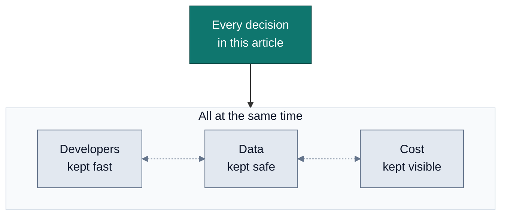

The good news is that most of the answers already exist, in another shape, in a well-built AWS landing zone:

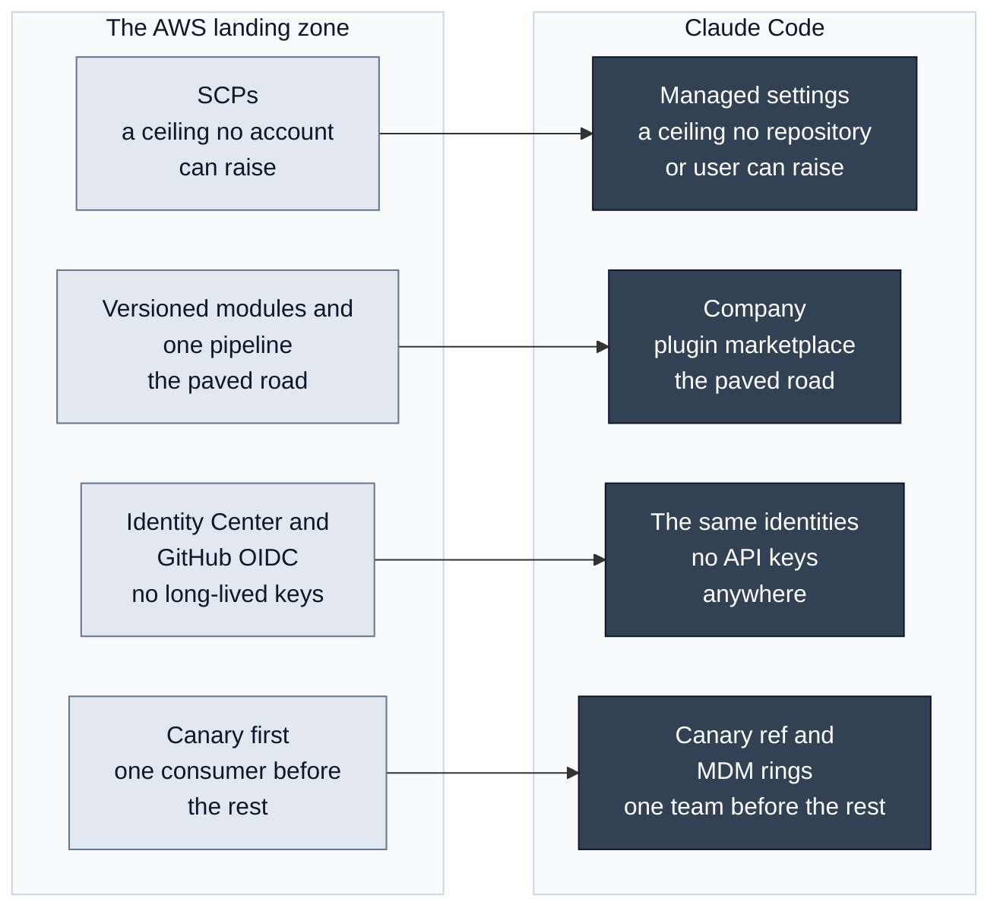

Everything here sits on that landing zone: the GitHub organization `my-org`, the Shared Services accounts (non-prod `333333333333`, prod `555555555555`), `us-east-1` with `us-west-2` for DR, and one region per Terraform run. The only new repository is the plugin marketplace.

## Decide Where Inference Runs First

Before any setting, one decision shapes all the others: where does the model run, and who processes the data? It decides the identity system, where policy comes from, which bill the spend lands on and which features you get. Changing it later means redoing most of what follows.

There are four realistic options for a company on AWS:

| | Amazon Bedrock | Claude Enterprise | Claude Platform on AWS | Claude apps gateway |
|---|---|---|---|---|
| **Who processes the data** | AWS | Anthropic | Anthropic | Whichever provider the self-hosted gateway routes to |
| **Identity** | IAM: Identity Center for people, OIDC for pipelines | SSO and SCIM | SigV4 or a workspace API key | OIDC sign-in, then a gateway token |
| **Where policy comes from** | Managed settings files, delivered by MDM | Server-managed settings, plus MDM | Managed settings files | Policies per identity-provider group |
| **Where spend shows up** | The AWS bill, tags and Budgets | Analytics and spend limits | The AWS bill, through Marketplace | Per-user and per-group spend limits |
| **What it gives up** | Server-managed settings, the analytics dashboard, web search, fast mode | IAM as the control plane; one more vendor data plane | GitHub Actions and server-managed settings; a new Anthropic organization | A service to run, with PostgreSQL; some features, such as server-side web search and the one-hour cache |

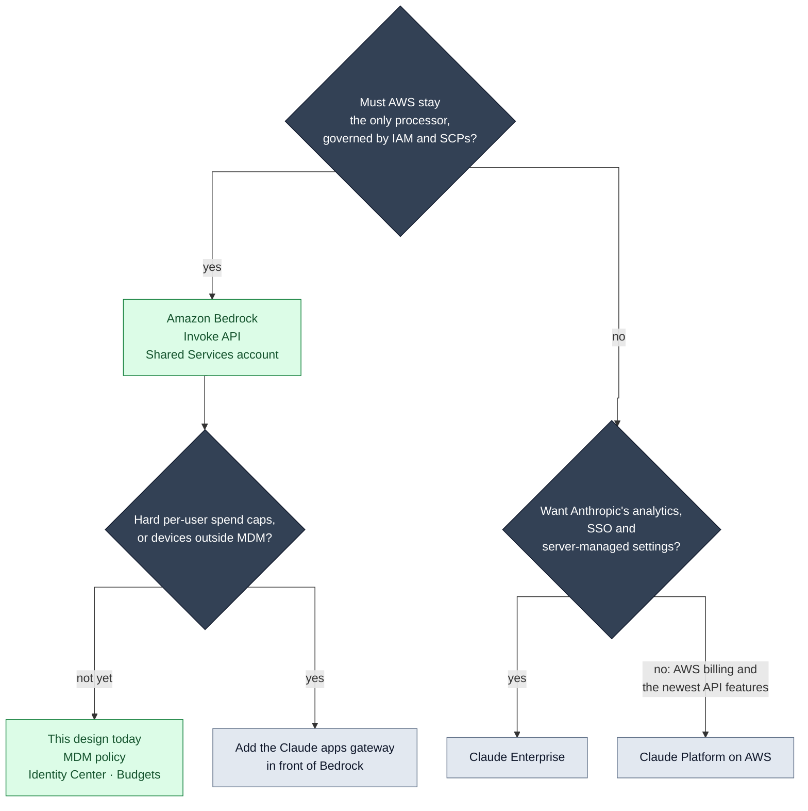

**I put inference on Bedrock, in the Shared Services account.** The reason is simple: the landing zone already governs it. Identity Center decides who can call it, SCPs set its ceiling, CloudTrail records it, tags and Budgets split its cost, and the spend lands on the AWS bill the company already reads. AWS stays the only processor of prompts and code, and no new vendor data plane shows up in the architecture review.

It costs something. Bedrock sessions don't fetch server-managed settings, and Claude Code sends no usage data to Anthropic from them, so the analytics dashboard is out; OpenTelemetry replaces both. Web search and fast mode aren't available. Auto mode works only on some models on Bedrock, the pinned Claude 5.5 models among them. If the analytics or first-party features ever outweigh having one control plane, I'd revisit the choice.

**Within Bedrock, the Invoke API, not Mantle.** Claude Code can reach Bedrock in two ways. `CLAUDE_CODE_USE_BEDROCK` uses the Invoke API. `CLAUDE_CODE_USE_MANTLE` uses Mantle, Bedrock's native Messages endpoint, which has its own IAM prefix (`bedrock-mantle:`) and its own model lineup, granted per account. I use the Invoke API because the three things this design depends on are documented there: application inference profile ARNs, `modelOverrides`, and the `enforceAvailableModels` startup checks. Claude Code's docs say nothing about per-team cost attribution on Mantle.

One tension, stated openly: the Claude Developer Platform's Bedrock page presents Mantle as the integration for Opus 4.7 and later. Claude Code's own Bedrock page is the authority for Claude Code, and it uses the Invoke API for Opus 5.5 (`us.anthropic.claude-opus-5-5`). AWS's model cards agree: they list Opus, Sonnet and Haiku 5.5 on the Invoke API, with `us.` profile IDs, as well as on Mantle. The first canary session confirms it in our own accounts, model by model.

**One central account, not one per team.** Model access, quotas and policy live in one place, and per-team cost and IAM still work, through inference profiles. The cost is a shared quota: one team can starve another. A heavy team can get its own account later, with the same Terraform.

**No gateway, for now.** The Claude apps gateway would add OIDC sign-in, policy per group, hard spend caps per user and provider credentials kept on the server. It's also another service to run, with PostgreSQL to keep highly available, and its sessions lose some features. Without it, spend control comes from Budgets: hours late, and an alarm rather than a cap. I'll add it when hard per-user caps or devices outside MDM become requirements.

## Identity: No Keys, Only Roles

The landing zone has no IAM users and no long-lived access keys, and Claude Code gets no exception: no Anthropic API key, no Bedrock API key, no access key in a dotfile. Every call to Bedrock uses short-lived credentials from a role.

**People come in through IAM Identity Center.** Each team gets a permission set, `ClaudeCode-<team>`, assigned in the Shared Services account. It references a customer managed policy, `claude-code-<team>`, that Terraform creates in that account and that can invoke only that team's models. The management project owns Identity Center, so it owns the permission sets; the Shared Services project owns the policies. It's the same split of ownership as the rest of the platform.

On the laptop, the onboarding script writes one AWS profile. The comment is there for the reader; the AWS config format only documents comments on their own line, so the real file carries just the account number:

```ini
[sso-session my-org]
sso_start_url = https://my-org.awsapps.com/start
sso_region = us-east-1
sso_registration_scopes = sso:account:access

[profile claude-code]
sso_session = my-org
sso_account_id = 555555555555   # 333333333333 for the canary team
sso_role_name = ClaudeCode-payments
region = us-east-1
```

Managed settings point Claude Code at it, and tell it how to renew it:

```json
{
  "allowedProviders": ["bedrock"],
  "env": {
    "CLAUDE_CODE_USE_BEDROCK": "1",
    "AWS_REGION": "us-east-1",
    "AWS_PROFILE": "claude-code"
  },
  "awsAuthRefresh": "aws sso login --profile claude-code"
}
```

`awsAuthRefresh` runs only when the credentials have expired. Claude Code checks with STS first, then opens the browser sign-in. When a developer leaves the company, disabling their corporate identity cuts off Claude Code along with everything else, as soon as the short-lived credentials they already hold expire. `AWS_PROFILE` lives in the managed `env` block on purpose: it applies to Claude Code without leaking into the developer's other processes. One documented catch: if a corporate proxy breaks the browser flow and it loops, the fix is to remove `awsAuthRefresh` and run `aws sso login` by hand.

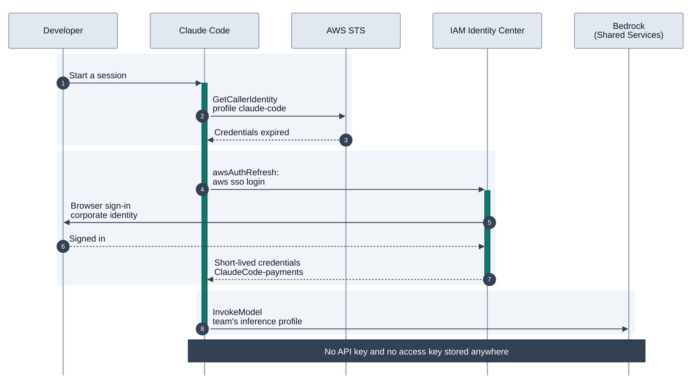

**`allowedProviders` closes the side door.** Without it, a developer could sign in with a personal subscription, and the company's code would go somewhere nobody reviewed. With `["bedrock"]`, Claude Code refuses any other provider at startup, at login and mid-session, Mantle included.

**Pipelines come in through GitHub OIDC, with exact subjects.** The CI reviewer we'll meet later assumes one role, `github-claude-code-review`, straight in the Shared Services account, with no hop through another account. Its trust policy names one repository and one context, never a pattern:

```hcl
  ci_review_trust = var.ci_review == null ? null : jsonencode({
    Version = "2012-10-17"
    Statement = [{
      Effect    = "Allow"
      Action    = "sts:AssumeRoleWithWebIdentity"
      Principal = { Federated = "arn:aws:iam::${var.account_id}:oidc-provider/token.actions.githubusercontent.com" }
      Condition = {
        StringEquals = {
          "token.actions.githubusercontent.com:aud" = "sts.amazonaws.com"
          "token.actions.githubusercontent.com:sub" = var.ci_review.subjects
        }
      }
    }]
  })
```

The subject comes from the definition, `repo:my-org/infrastructure-aws-shared-services:pull_request` for the pilot, and the variable refuses anything with a wildcard. A test proves it: a definition with `repo:my-org/*:pull_request` fails. The session lasts one hour, and the role's only permission is the policy of the team it bills to, so the reviewer can call Claude and nothing else in AWS. As in the AWS article, repositories created after July 15, 2026 send a subject that also carries the numeric IDs of the owner and the repository, so the subject is copied from a real token, not typed from memory.

## The Ceiling: Managed Settings Are the SCPs of Claude Code

An SCP never grants anything. It sets the ceiling for every principal in the account, administrators included. Claude Code has the same construct. Managed settings sit above every other source of configuration, and nothing below them can raise what they set.

Claude Code reads settings from five places. Managed settings come first, then `--settings` on the command line, then the repository's `.claude/settings.local.json` and `.claude/settings.json`, and last the developer's `~/.claude/settings.json`. Lists merge across scopes, so a repository can add its own deny rules but never remove the company's, and a deny at any scope wins. Some keys only count when they come from managed settings, such as `allowManagedHooksOnly`, `strictKnownMarketplaces` and `allowedProviders`. Put them in a repository file and they do nothing, which is exactly what you want from a ceiling.

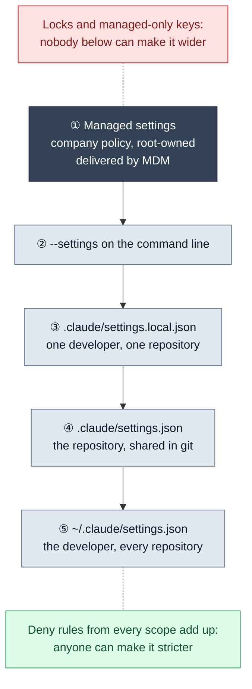

**How it reaches machines.** MDM writes the policy as root-owned files that developers can't edit: `/Library/Application Support/ClaudeCode/managed-settings.json` on macOS, `/etc/claude-code/managed-settings.json` on Linux and WSL2. Server-managed settings from the claude.ai console aren't an option, because Bedrock sessions don't fetch them. Native Windows has no sandbox, and the policy refuses to start without one, so Windows developers use WSL2.

**One baseline, one drop-in per team.** `managed-settings.json` is the company baseline, identical on every machine. Next to it, in `managed-settings.d/`, each team's machines get one more file. Claude Code reads the base file, then the drop-ins in alphabetical order: scalars from the later file win, lists are unioned, and nested objects such as `env` merge key by key. Terraform generates each team's drop-in from the resources it just created (`terraform output claude_code_team_settings`), and MDM sends it to that team's device group. This is the canary team's:

```json
{
  "env": {
    "OTEL_RESOURCE_ATTRIBUTES": "department=engineering,team.id=platform,cost_center=cc-1000",
    "PLATFORM_TEAM": "platform"
  },
  "modelOverrides": {
    "claude-opus-5-5": "arn:aws:bedrock:us-east-1:333333333333:application-inference-profile/p1a7f0rm0pus",
    "claude-sonnet-5-5": "arn:aws:bedrock:us-east-1:333333333333:application-inference-profile/p1a7f0rmsonn",
    "claude-haiku-5-5": "arn:aws:bedrock:us-east-1:333333333333:application-inference-profile/p1a7f0rmhaik"
  },
  "extraKnownMarketplaces": {
    "my-org-platform": {
      "source": { "source": "github", "repo": "my-org/claude-code-marketplace", "ref": "canary" },
      "autoUpdate": true
    }
  }
}
```

Only three things vary per team: where its spend is attributed, which inference profiles it uses and, for the canary team only, which release of the paved road it follows. A machine with no team drop-in doesn't fall back to something open. Its models resolve to Bedrock's system inference profiles, which no IAM policy grants, so it can't invoke anything. It fails closed.

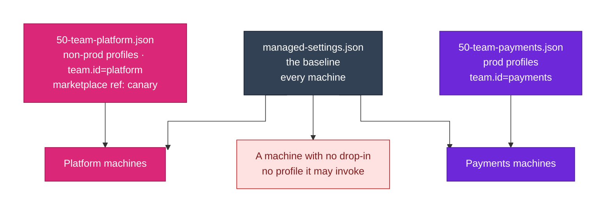

**What the ceiling locks.** The baseline is long, but it answers a short list of questions:

| Question | Managed keys | The answer |
|---|---|---|
| Can anyone turn the permission checks off? | `permissions.disableBypassPermissionsMode` | No. Bypass mode and `--dangerously-skip-permissions` are disabled |
| Which provider? | `allowedProviders` | Bedrock only |
| Which models, at what effort? | `availableModels`, `enforceAvailableModels`, `deniedModels`, `maxEffortLevel` | Opus 5.5, Sonnet 5.5 and Haiku 5.5. Fable, at 2.5 times Opus 5.5's price, is denied. Effort is capped at `high` |
| Who can pre-approve commands? | `allowManagedPermissionRulesOnly` | Only the company. A repository can't pre-approve commands for everyone who opens it |
| What can shell commands reach? | `sandbox` | Writes only in the working directory, no credentials, an allowlist of hosts |
| Which plugins? | `strictKnownMarketplaces`, `enabledPlugins`, `disableSideloadFlags` | Only the company marketplace, with guardrails and standards always on |
| Which MCP servers? | `allowManagedMcpServersOnly`, `allowedMcpServers` | Two, pinned to exact versions |
| Whose hooks run? | `allowManagedHooksOnly` | Only the company's |
| Which Claude Code version? | `requiredMinimumVersion`, `DISABLE_AUTOUPDATER` | A floor, and updates rolled out in rings |

Every lock has a price. For `allowManagedPermissionRulesOnly`, it's that teams ask the platform team for new allow rules, the way they'd ask for an SCP exception. The price of the others comes up in the sections that follow.

**Model choice is a cost decision.** The default session model is Sonnet 5.5, which handles most coding at half the price of Opus 5.5, and Opus stays one `/model` away. Every alias is pinned with `ANTHROPIC_DEFAULT_OPUS_MODEL` and its siblings, because unpinned aliases move with Claude Code releases and an unpinned primary is billed at the Opus rate. A managed `model` is only a default; the lock is `availableModels` with `enforceAvailableModels`.

**Manual mode first, auto mode as an opt-in.** Auto mode lets a classifier, a second model, approve tool calls. It cuts prompts, but it's a model's judgment, not a boundary, and it runs on our Bedrock bill. So sessions start in Manual mode. With the sandbox auto-allowing the commands that stay inside it, Manual mostly prompts for edits, pushes and web fetches. A shell command that needs a host outside the allowlist isn't prompted for; it's blocked. The company's auto mode rules, with hard blocks on applies and credential reads, are already in the policy for teams that opt in.

### Deny Rules Guide. The Sandbox Enforces.

This is the point most often gotten wrong. A deny rule like `Bash(terraform apply *)` matches the text of a command. It stops the usual invocation, not the same command wrapped in `sh -c`, run from a script, or called by its full path. The docs are explicit: Bash prefix rules cover the usual invocation, and enforcement belongs to the sandbox or a hook. Bash deny rules are useful guidance for the agent, not a wall.

The wall is the sandbox. Every shell command Claude runs, and every process it starts, runs inside an OS-level boundary: Seatbelt on macOS, bubblewrap on Linux and WSL2. Writes are limited to the working directory and a per-user temp directory, and network traffic goes through a proxy that only allows the hosts on a list. However the command was spelled, it hits the same wall.

There's a catch that changes the design. By default, sandboxed commands can read the whole disk, credentials included. So the policy denies them explicitly, and unsets the variables that hold them:

```json
{
  "sandbox": {
    "enabled": true,
    "failIfUnavailable": true,
    "allowUnsandboxedCommands": false,
    "autoAllowBashIfSandboxed": true,
    "credentials": {
      "files": [
        { "path": "~/.aws", "mode": "deny" },
        { "path": "~/.ssh", "mode": "deny" },
        { "path": "~/.config/gh", "mode": "deny" }
      ],
      "envVars": [
        { "name": "AWS_ACCESS_KEY_ID", "mode": "deny" },
        { "name": "AWS_SECRET_ACCESS_KEY", "mode": "deny" },
        { "name": "AWS_SESSION_TOKEN", "mode": "deny" },
        { "name": "AWS_BEARER_TOKEN_BEDROCK", "mode": "deny" }
      ]
    },
    "network": {
      "allowManagedDomainsOnly": true,
      "allowedDomains": [
        "github.com",
        "registry.terraform.io",
        "releases.hashicorp.com",
        "pypi.org"
      ]
    }
  }
}
```

Three settings do most of the work. `failIfUnavailable` makes Claude Code refuse to start rather than run unsandboxed. `allowUnsandboxedCommands: false` removes the "retry outside the sandbox" escape hatch, and makes the sandbox one that repository settings can't widen. And there's no `*.amazonaws.com` on the network list: from a laptop, no shell command Claude runs can reach an AWS API at all.

The wall has two documented gaps, and I'd rather name them. The proxy decides on the hostname without inspecting TLS, so the docs warn that a broad entry such as `github.com` can be an exfiltration path; that's why the list stays short. And a developer's own `~/.claude/settings.json` can still add `excludedCommands` or write paths, because neither has a managed-only lock. An excluded command runs outside the sandbox through the normal permission flow, so that's a choice the developer makes, not one the agent or a repository can.

```mermaid
%%{init: {"flowchart": {"curve": "stepAfter", "nodeSpacing": 40, "rankSpacing": 60, "wrappingWidth": 280}}}%%
flowchart LR
    ask(["Claude tries<br/>terraform apply"])
    l1["① Deny rule<br/>matches the<br/>usual spelling"]
    l2["② Guardrail hook<br/>parses the command, sh -c included<br/>and points at the pipeline"]
    l3["③ Sandbox<br/>no AWS credentials<br/>no AWS endpoints"]
    l4["④ IAM<br/>developer roles have<br/>no apply rights in prod"]
    pipe["The pipeline<br/>the only way<br/>changes reach AWS"]

    ask --> l1 --> l2 --> l3 --> l4 --> pipe

    classDef prod fill:#6d28d9,stroke:#4c1d95,color:#ffffff
    classDef security fill:#334155,stroke:#0f172a,color:#ffffff
    classDef neutral fill:#e2e8f0,stroke:#64748b,color:#0f172a
    class ask neutral
    class l1,l2,l3,l4 security
    class pipe prod
```

**What the sandbox costs.** It isolates shell commands only. Claude's own file tools, WebFetch, MCP servers and hooks run outside it, which is why the policy also has `Read` deny rules for the same paths, WebFetch rules per domain, the MCP allowlist, and `CLAUDE_CODE_SUBPROCESS_ENV_SCRUB` to strip credentials from hooks and MCP servers. And developers will feel its limits:

- No `terraform plan` from Claude on a laptop. Claude writes and statically checks infrastructure code; plans and applies run in the pipeline.
- Private module downloads need git credentials the sandbox denies, so developers run `terraform init` once themselves.
- git over SSH can't get through the sandbox's proxy, and git's credentials are denied inside it, so developers push themselves. I count that as a feature: a push starts a pipeline.
- The docs warn that tools such as `terraform` and `gh` may fail TLS verification under macOS Seatbelt. The canary machines settle that.

For a platform team that's the right trade: the agent writes and checks, and the pipeline changes things, exactly as it does for people.

## Enforcement in Code, Not in Prompts

A rule written in a prompt is a request. A model follows it most of the time, and "most of the time" isn't a control. So anything that must hold is enforced by code that runs whatever the model decides. In Claude Code, that code is a hook: a command that runs at a point in the session's life, reads a JSON description of what's about to happen on standard input, and answers with an exit code. The contract is small:

- Exit 0 with nothing on standard output: no opinion, carry on.
- Exit 0 with a JSON decision: the JSON decides, for example denying a tool call with a reason Claude can read.
- Exit 2: a blocking error. On `PreToolUse` and `UserPromptSubmit`, the action doesn't happen.
- Any other exit code without a valid JSON decision: a non-blocking error. It enforces nothing, which is a classic way to write a guardrail that never blocks.

The company's guardrails ship as a plugin, `platform-guardrails`, wired to four events:

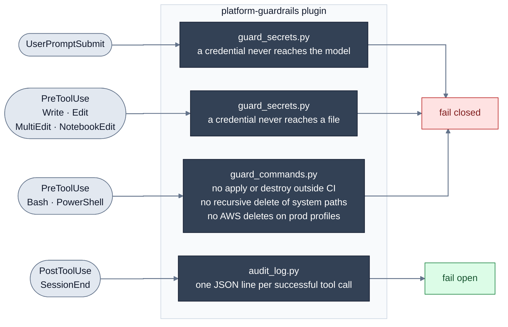

This is the wiring of the command guard:

```json
{
  "hooks": {
    "PreToolUse": [
      {
        "matcher": "Bash|PowerShell",
        "hooks": [
          {
            "type": "command",
            "command": "python3",
            "args": ["${CLAUDE_PLUGIN_ROOT}/scripts/guard_commands.py"],
            "timeout": 10,
            "onFailure": "block",
            "statusMessage": "Checking the command against platform policy"
          }
        ]
      }
    ]
  }
}
```

**`onFailure: "block"` is the line that matters most.** If `python3` is missing or the script crashes, a hook error normally lets the tool call go ahead. With `onFailure: "block"`, a broken guardrail blocks instead of silently disappearing. The audit hook is the opposite on purpose: it fails open, because an audit outage should never stop work, and OpenTelemetry is a second, independent record.

**Why a hook and not a permission rule.** Deny rules match paths and command prefixes, never content. Only a hook can look at what's about to be written and see an AWS key in it. The secrets guard checks prompts before they reach the model and file writes before they reach the disk. Two details make it usable. It allows AWS's own documentation placeholder keys, because a guardrail that cries wolf on every README gets bypassed. And it doesn't scan the text an edit replaces, so Claude can still remove a leaked key.

**A deny should teach.** When the command guard refuses something, it says why, in words Claude can act on:

```python
def check_terraform(words):
    if not words or os.path.basename(words[0]) not in TERRAFORM_BINARIES:
        return None
    # ...
    if in_ci():
        return None
    return (
        action + " runs only in the pipeline (reviewed plan, OIDC role, approval on prod). "
        "Run plan/validate locally, open a pull request, and let the pipeline apply."
    )
```

The reason goes back to the model in the hook's JSON answer, so Claude's next move is a pull request, not a workaround. The guard reads `CI` from its own environment, so an inline `CI=true terraform apply` doesn't count. And its docstring says what it isn't: a security boundary. It looks inside `sh -c` and backticks, but a script that runs terraform gets through. The boundaries are the sandbox and IAM; the hook stops the obvious attempt and explains why.

**A backstop that doesn't depend on the plugin.** The managed settings carry one more hook, inline Python inside the JSON, that blocks `terraform` and `tofu` apply and destroy outside CI. Testing caught a bug in its first version: it also blocked `grep -rn 'terraform apply' docs`. That's the kind of false positive that gets a guardrail switched off, so it now matches terraform only where a command starts.

**Tested like code.** Contract tests pipe the exact JSON Claude Code sends into each script and assert the exit code and output, from `-chdir`, `tofu`, `sh -c` and backtick spellings of terraform to malformed input. An eval suite runs three cases against a real model, with and without the plugin, including a control case that proves ordinary Terraform work trips nothing. It calls a model, so it runs on release candidates.

**`allowManagedHooksOnly`, and what it costs.** A repository's committed hooks run as soon as its folder is trusted, or straight away in a non-interactive `-p` run, so a cloned repository can run its hook code on a developer's machine. With `allowManagedHooksOnly: true`, only managed hooks and the hooks of plugins force-enabled by managed settings run, matched on their full `plugin@marketplace` name. That closes the hole.

The cost is real. Teams can't add their own hooks, such as a formatter after every edit, `/goal` doesn't work, and status lines become managed-only. A team contributes its hook to the marketplace instead, where it's reviewed, tested and versioned. Like an SCP exception, it's slower the first time, and then the whole organization has it.

## The Paved Road: A Plugin Marketplace, Released Like Modules

Guardrails say what people can't do. A platform earns its keep by making the right thing the easy thing. In the landing zone that's the versioned modules and the central pipeline. For Claude Code, it's a company plugin marketplace: one git repository, `my-org/claude-code-marketplace`, that every machine pulls from. A plugin can carry skills, subagents, hooks and MCP servers; the marketplace is the catalog:

```json
{
  "name": "my-org-platform",
  "plugins": [
    {
      "name": "platform-guardrails",
      "source": "./plugins/platform-guardrails",
      "category": "security"
    },
    {
      "name": "platform-standards",
      "source": "./plugins/platform-standards",
      "category": "development"
    },
    {
      "name": "platform-mcp",
      "source": "./plugins/platform-mcp",
      "category": "documentation",
      "defaultEnabled": false
    }
  ]
}
```

- **`platform-guardrails`**: hooks only, the ones from the previous section. Hooks run in the harness, not in the model's context, so it costs about zero tokens. Force-enabled.
- **`platform-standards`**: the platform team's conventions as skills, `terraform-conventions` and `aws-pr-review`, a read-only `iac-reviewer` subagent, and a manual command that scaffolds a definition folder. Force-enabled.
- **`platform-mcp`**: two read-only documentation MCP servers, for AWS and the Terraform Registry. Opt-in, because it needs `uv` and Docker.

**One version, in one place.** A plugin's version lives in its `plugin.json`, and only there. The marketplace entry has no version, so the two can never disagree:

```json
{
  "name": "platform-guardrails",
  "displayName": "Platform guardrails",
  "version": "1.0.0",
  "repository": "https://github.com/my-org/claude-code-marketplace",
  "license": "UNLICENSED"
}
```

The version also pins users: they stay on a release until the string changes, even if the branch moves. That's the module rule from the AWS article. A version means the same code until someone deliberately releases a new one.

**The same pipeline, for plugins.** The release flow in the marketplace's README has every pull request run checks that call no model: `claude plugin validate --strict` on the marketplace and on each plugin, the hook contract tests and, when an MCP server changes, a smoke test that starts the pinned servers and lists their tools. `--strict` turns warnings into failures, which is the mode for CI. After the merge, `claude plugin tag` creates the release tag, such as `platform-guardrails--v1.0.0`, but only after checking that the manifest and the marketplace entry agree.

**Two refs: canary and stable.** Every machine follows the `stable` branch. The platform team's drop-in, which we saw in the ceiling section, points at `canary`. A release moves `canary` first, and the eval suite runs against it with a real model:

```bash
claude plugin eval plugins/platform-guardrails --allow-tools Write "Bash(terraform *)" \
  --runs 3 --max-cost-usd 5 --no-publish --json results.json
```

A useful guardrail scores high with the plugin and low without it, and the control case shows it doesn't get in the way of normal work. After a week without incidents, `stable` moves to the same commit and every other machine picks it up. It's the pipeline canary from the AWS article, applied to plugins.

```mermaid
%%{init: {"flowchart": {"curve": "stepAfter", "nodeSpacing": 40, "rankSpacing": 60}}}%%
flowchart LR
    subgraph build["Build and tag"]
        direction LR
        pr(["pull request"]) --> chk["no-model checks<br/>validate --strict<br/>hook tests, MCP smoke test"]
        chk --> merge["merge to main"]
        merge --> tag["claude plugin tag<br/>platform-guardrails--v1.0.0"]
    end
    subgraph roll["Canary to stable"]
        direction LR
        can["canary ref<br/>platform team machines"] --> ev["eval suite<br/>with and without<br/>the plugin"]
        ev --> wk["a week without incidents"]
        wk --> st["stable ref<br/>every other machine"]
    end
    tag --> can
    linkStyle default stroke:#64748b,stroke-width:1.5px

    classDef prod fill:#6d28d9,stroke:#4c1d95,color:#ffffff
    classDef nonprod fill:#db2777,stroke:#9d174d,color:#ffffff
    classDef security fill:#334155,stroke:#0f172a,color:#ffffff
    classDef neutral fill:#e2e8f0,stroke:#64748b,color:#0f172a
    classDef allowed fill:#dcfce7,stroke:#15803d,color:#14532d
    classDef accent fill:#0f766e,stroke:#134e4a,color:#ffffff
    class pr,merge neutral
    class chk,ev security
    class tag accent
    class can nonprod
    class wk allowed
    class st prod
    style build fill:#f8fafc,stroke:#cbd5e1,color:#0f172a
    style roll fill:#f8fafc,stroke:#cbd5e1,color:#0f172a
```

**The managed side makes it the only road.** Four keys in the baseline turn the marketplace from an option into the standard:

```json
{
  "strictKnownMarketplaces": [
    { "source": "github", "repo": "my-org/claude-code-marketplace", "ref": "stable" },
    { "source": "github", "repo": "my-org/claude-code-marketplace", "ref": "canary" }
  ],
  "extraKnownMarketplaces": {
    "my-org-platform": {
      "source": { "source": "github", "repo": "my-org/claude-code-marketplace", "ref": "stable" },
      "autoUpdate": true
    }
  },
  "enabledPlugins": {
    "platform-guardrails@my-org-platform": true,
    "platform-standards@my-org-platform": true
  },
  "disableSideloadFlags": true
}
```

`strictKnownMarketplaces` is the allowlist. It matches the repository and the ref exactly, which is why both refs are listed, and it allows nothing else, the official marketplace included. `extraKnownMarketplaces` registers the company marketplace everywhere. `enabledPlugins` installs the guardrails and the standards, and a managed `true` can't be turned off. `disableSideloadFlags` rejects `--plugin-dir`, `--agents` and `--mcp-config`, which would otherwise load anything for one session; plugin authors develop in a container whose policy leaves it out.

Claude Code itself is released the same way. Background self-update is off (`DISABLE_AUTOUPDATER`), MDM pushes a new version to the canary ring first, and `requiredMinimumVersion` sets the floor every key in the policy needs. Plugins keep updating (`FORCE_AUTOUPDATE_PLUGINS`) from the ref their ring follows. The cost is that someone owns the patch cadence, security fixes included.

## Context Is Code Too

Claude Code has four ways to give the model knowledge: CLAUDE.md, skills, subagents and MCP servers. Each costs something different and is good at different things. I treat the choice like any placement decision in a platform: each thing goes where it's cheapest to keep right.

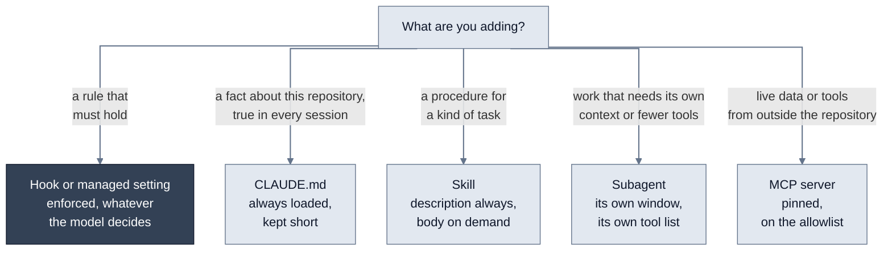

**CLAUDE.md is always on.** Every session loads it, from the managed level down to the repository, all concatenated. That makes it the place for what's true about this repository every time: how to run the tests, what the layout means. It's also paid for on every request, so I keep it short; the docs suggest under 200 lines.

And CLAUDE.md never carries enforcement. It's context, not a control, and the docs say so: to block an action regardless of what Claude decides, use a hook. "Never run terraform apply" in CLAUDE.md is a wish. As a hook, it's a rule.

**Skills load when they're needed.** A skill's description is always in context; its instructions load only when it's invoked. That makes skills the place for procedures, such as how the platform team reviews an infrastructure pull request. Claude loads the conventions skill on its own only when it's working with Terraform files:

```yaml
---
name: terraform-conventions
description: The organization's Terraform layout and rules (skeleton plus definitions, one region per run, the providers.tf rule, module pinning, state naming, static checks). Use when writing, changing or reviewing any Terraform in a my-org infrastructure-* or terraform-aws-* repository, or when someone asks how a project should be laid out.
paths: ["**/*.tf", "**/*.tfvars", "**/backend.hcl"]
---
```

Commands have been merged into skills. A skill with `disable-model-invocation: true` runs only when a person types it, which is how `/platform-standards:new-definition` works: it writes two files, and only when asked.

**Subagents get their own context and their own tools.** A subagent runs in a separate context window with a tool list of its own. The `iac-reviewer` can read and search, and nothing else:

```yaml
---
name: iac-reviewer
tools: Read, Grep, Glob
model: sonnet
maxTurns: 20
---
```

A reviewer that can change what it reviews isn't a reviewer. The review skill hands a large diff to it one project at a time, and the main session only sees the findings. Plugin subagents ignore `hooks`, `mcpServers` and `permissionMode` in their frontmatter, which suits this design: enforcement stays in `hooks.json` and the managed settings, never in an agent definition.

**MCP servers bring live data and tools.** An MCP server is the answer when the model needs something it can't read from the repository, like the current docs for a Terraform provider. Each local one is a process on the developer's machine, so each one is a supply-chain decision. The two in `platform-mcp` read public documentation only and need no credentials, and the managed allowlist pins their exact commands, the Terraform one by image digest:

```json
{
  "allowManagedMcpServersOnly": true,
  "allowedMcpServers": [
    { "serverCommand": ["uvx", "awslabs.aws-documentation-mcp-server@1.2.2"] },
    {
      "serverCommand": [
        "docker",
        "run",
        "-i",
        "--rm",
        "--read-only",
        "--cap-drop=ALL",
        "--security-opt=no-new-privileges",
        "hashicorp/terraform-mcp-server:1.3.0@sha256:423a6b8e2ee06affcf090892f40c86469caba45fd2448ffa8ca5d717a174f7d5",
        "--toolsets=registry"
      ]
    }
  ]
}
```

The match is exact, command and arguments, so a plugin release that bumps a server must bump the allowlist in the same pull request. That coupling is deliberate: the ceiling pins the binary, and a small script checks that both files agree. I don't use the other mechanism, `managed-mcp.json`, because it takes exclusive control and would block the paved road's own plugin servers.

**Measure what context costs.** `claude plugin details` reports what each plugin adds. The standards plugin adds about 523 tokens to every session for its descriptions, and loads each skill or agent on demand, at about 500 to 1,800 tokens each. That's the number to watch as the catalog grows.

## Inference as a Shared Service

With Bedrock in Shared Services, inference becomes what the container registry already is in the landing zone: a shared service every team consumes and the platform team operates. It raises the registry's questions: who can use it, who pays for what, and what happens when one team uses too much?

**One inference profile per team and model.** Bedrock's system inference profiles, such as `us.anthropic.claude-sonnet-5-5`, are shared by everyone in the account, so they can't tell teams apart. An application inference profile can: it's a copy of a system profile with its own ARN and its own tags. Terraform creates one per team and model, in each region:

```hcl
resource "aws_bedrock_inference_profile" "team" {
  for_each = local.regional ? local.team_models : {}

  name        = "claude-code-${each.value.team}-${each.value.model}"

  model_source {
    copy_from = "arn:aws:bedrock:${var.region}:${var.account_id}:inference-profile/${var.models[each.value.model]}"
  }

  tags = {
    Team       = each.value.team
    CostCenter = each.value.cost_center
    Model      = each.value.model
  }
}
```

The tags do two jobs. Cost: the Bedrock user guide documents tags on an application profile as the way to track its cost, so the `Team` and `CostCenter` cost allocation tags split the bill per team. That the tag really lands on the line items for Anthropic models is something only a real bill shows, so the canary month checks it. Control: each team's IAM policy can invoke only profiles with its own `Team` tag:

```hcl
          {
            Sid      = "InvokeOnlyThisTeamsProfiles"
            Effect   = "Allow"
            Action   = ["bedrock:InvokeModel", "bedrock:InvokeModelWithResponseStream", "bedrock:GetInferenceProfile"]
            Resource = local.application_profile_arns
            Condition = {
              StringEquals = { "aws:ResourceTag/Team" = team }
            }
          },
          {
            Sid      = "FoundationModelsOnlyThroughProfiles"
            Effect   = "Allow"
            Action   = ["bedrock:InvokeModel", "bedrock:InvokeModelWithResponseStream"]
            Resource = "arn:aws:bedrock:*::foundation-model/anthropic.claude-*"
            Condition = {
              ArnLike = { "bedrock:InferenceProfileArn" = concat(local.application_profile_arns, local.system_profile_arns) }
            }
          },
```

The second statement is the subtle one. A request through a cross-region profile is also authorized against the foundation model, and Bedrock sets `bedrock:InferenceProfileArn` on that check. Requiring it means the model can only be reached through a profile, and the first statement decides which one. A session can't spend on another team's line or skip attribution through the system profile. The condition accepts both the application profile and the system profile it was copied from, because which one Bedrock puts in that key is something the first canary call shows.

**Developers keep using model names.** The team's drop-in maps each model ID to the team's profile with `modelOverrides`. Claude Code still recognizes the model, with its 1M context, effort levels and thinking; with an ARN pinned directly, it wouldn't. And with `availableModels` managed, only managed overrides apply to the pinned IDs, so a developer's own file can't reroute them; IAM would refuse another team's profile anyway.

```mermaid
%%{init: {"flowchart": {"curve": "stepAfter", "nodeSpacing": 40, "rankSpacing": 60, "wrappingWidth": 320}}}%%
flowchart LR
    subgraph laptop["A payments developer's session"]
        m["claude-sonnet-5-5"]
    end
    h[" "]:::hidden
    subgraph ss["Shared Services Prod · 555555555555"]
        ap["application inference profile<br/>claude-code-payments-claude-sonnet-5-5<br/>Team=payments · CostCenter=cc-2001"]
        pol["IAM policy claude-code-payments<br/>aws:ResourceTag/Team = payments"]
        sp["system profile<br/>us.anthropic.claude-sonnet-5-5"]
        bud["AWS Budget claude-code-payments<br/>filter: Team = payments"]
    end
    r["us-east-1 · us-east-2 · us-west-2"]

    ap ~~~ sp
    m -- "modelOverrides<br/>from the team drop-in" ---> ap
    ap -- "copied from" --> sp
    sp --> r
    pol -. "allows only this<br/>team's profiles" .-> ap
    ap -. "cost allocation tags" .-> bud
    h ~~~ pol

    classDef prod fill:#6d28d9,stroke:#4c1d95,color:#ffffff
    classDef security fill:#334155,stroke:#0f172a,color:#ffffff
    classDef neutral fill:#e2e8f0,stroke:#64748b,color:#0f172a
    classDef hidden fill:none,stroke:none,width:0px
    class m,r neutral
    class ap,sp,bud prod
    class pol security
    style laptop fill:#f8fafc,stroke:#cbd5e1,color:#0f172a
    style ss fill:#f8fafc,stroke:#cbd5e1,color:#0f172a
    linkStyle 1,2,3 stroke:#64748b,stroke-width:2px
    linkStyle 4,5 stroke:#64748b,stroke-width:1.5px
```

**Quotas are shared, so plan them.** One central account means one quota. On the Invoke API, that's the account's Bedrock service quotas for each model's cross-region profile, in tokens and requests per minute. The 2 million input tokens per minute on the Claude in Amazon Bedrock page belong to the Messages endpoint, which keeps separate input and output quotas, so they aren't the numbers to plan with here. Output tokens count more than input: the Bedrock user guide's burndown table counts one Opus 5.5 output token as ten tokens of quota, against five for Claude 4.7 and earlier, while cache reads count for nothing. The table doesn't list Sonnet 5.5 or Haiku 5.5 yet, so the canary measures them. The Claude Code docs' planning example makes the point: 200 developers at 20,000 tokens per minute each need 4 million. So quota increases are requested from the canary's real numbers, ahead of each wave.

**Budgets per team, with honest expectations.** Each team gets a monthly AWS Budget on its `Team` tag, which emails its leads at 80% of actual spend and 100% of forecast. Budget data lags by hours, so it's an alarm, not a cap. A hard per-user cap is what the Claude apps gateway would add, and needing one is the trigger I'd use to add it.

### The Region SCP Meets Cross-Region Inference

This is the one I'd have missed without reading the Bedrock user guide closely. The landing zone's root SCP denies every region except `us-east-1` and `us-west-2`. A US cross-region profile routes requests to `us-east-1`, `us-east-2` and `us-west-2`, and Bedrock authorizes each one against the foundation model in the destination region. `us-east-2` isn't approved, so the SCP denies it, and Claude Code fails in a way that looks like a Bedrock problem.

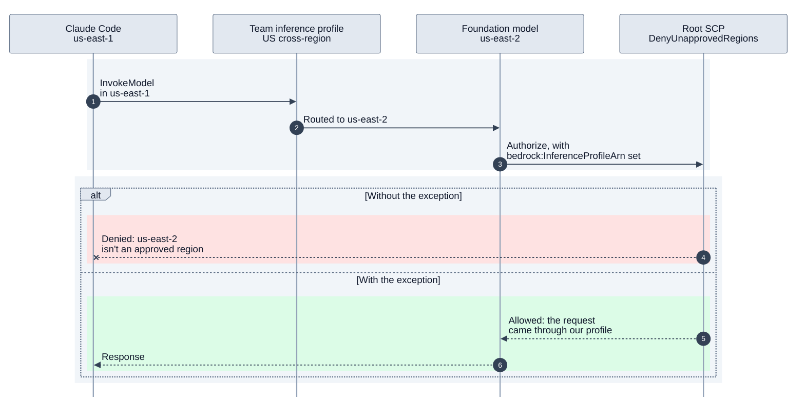

The fix is documented. Bedrock sets `bedrock:InferenceProfileArn` on the foundation-model checks, destinations included, but not on the check of the profile itself, so the key can't unlock the originating call. So the region statement in the management project gets an exception for requests made through our own profiles, and nothing else:

```json
    {
      "Sid": "DenyUnapprovedRegions",
      "Effect": "Deny",
      "NotAction": ["<global services, unchanged>"],
      "Resource": "*",
      "Condition": {
        "StringNotEquals": { "aws:RequestedRegion": ["us-east-1", "us-west-2"] },
        "ArnNotLike": {
          "bedrock:InferenceProfileArn": [
            "arn:aws:bedrock:*:333333333333:application-inference-profile/*",
            "arn:aws:bedrock:*:555555555555:application-inference-profile/*",
            "arn:aws:bedrock:*:333333333333:inference-profile/us.anthropic.claude-*",
            "arn:aws:bedrock:*:555555555555:inference-profile/us.anthropic.claude-*"
          ]
        }
      }
    }
```

This is the AWS article's lesson again: the guardrail is a ceiling, and every new service has to be checked against it, not assumed to fit. It's also why I chose the US geographic profile over the global one. The global profile is about 10% cheaper, and the same kind of exception would cover it, but it routes prompts to commercial regions worldwide. Keeping them in the US is a data-residency decision, and I'd rather make it explicitly than inherit it from a price.

The one-region rule still holds. Each region's profiles come from that region's own definition, and the IAM policies and budgets from the global definition, applied first. Production also has profiles in `us-west-2`, the DR copy, so moving a team there is a drop-in change: a new region and new ARNs.

## Seeing What Happens

Claude Code on Bedrock sends no usage data to Anthropic, so Anthropic's analytics can't help. That's fine. OpenTelemetry is built into Claude Code, and it gives the per-user and per-team view of how the tool is used; Bedrock's own cost attribution covers the bill. The design questions are the ones for any shared service: what do we collect, where does it land, and who can tamper with it?

**The managed settings fix where telemetry goes.**

```json
{
  "env": {
    "CLAUDE_CODE_ENABLE_TELEMETRY": "1",
    "OTEL_METRICS_EXPORTER": "otlp",
    "OTEL_LOGS_EXPORTER": "otlp",
    "OTEL_EXPORTER_OTLP_PROTOCOL": "http/protobuf",
    "OTEL_EXPORTER_OTLP_ENDPOINT": "https://otel.shared-services.internal.example.com:4318",
    "OTEL_METRICS_INCLUDE_SESSION_ID": "false",
    "OTEL_LOG_TOOL_DETAILS": "1",
    "OTEL_RESOURCE_ATTRIBUTES": "department=engineering,team.id=unassigned,cost_center=unassigned"
  }
}
```

Once the endpoint is managed, endpoints set anywhere else are dropped, and repositories can't set exporter variables at all. The base file says `team.id=unassigned`; each team's drop-in replaces it with the real team and cost center. That's team attribution no repository can override, and a machine without a team stands out on the first dashboard.

Two settings are about restraint. Session IDs stay off the metrics, which keeps cardinality, and the CloudWatch bill, down. And prompt text is off; a developer could turn it on in their own shell, so the collector deletes it anyway. Tool details are on, because knowing which tools, skills, plugins and MCP servers people actually use is how the platform team knows whether the paved road works.

**One collector, CloudWatch only.** The collector runs in Shared Services as an ECS task behind an internal load balancer that terminates TLS. Its role can write only to the `/claude-code/` log groups, which have their own KMS key. Metrics become CloudWatch metrics through the embedded metric format, with a deliberate set of dimensions:

```yaml
  awsemf:
    region: ${env:AWS_REGION}
    namespace: ClaudeCode
    dimension_rollup_option: NoDimensionRollup # only the dimension sets below: each set is a billed metric
    metric_declarations:
      - dimensions: [[team.id, model], [team.id], [cost_center]]
        metric_name_selectors:
          - ^claude_code\.cost\.usage$
      - dimensions: [[team.id, model, type], [team.id, type]]
        metric_name_selectors:
          - ^claude_code\.token\.usage$
```

Events, such as `api_request` with its cost or `tool_decision` with accepts and rejects, go to a log group for Logs Insights. CloudWatch is one service the company already operates. I'd move to Amazon Managed Prometheus and Grafana once teams want high-cardinality questions answered ad hoc, and only the collector's exporters would change.

**The audit trail, from the hooks.** The audit hook writes one JSON line per successful tool call: who, where, which tool, and what it acted on. Failed and denied calls don't reach `PostToolUse`; they show up in the OpenTelemetry events instead. Commands go through the same credential patterns the guards use, so a leaked key isn't copied into the trail, and it never records tool output or file contents. The file is local, mode 0600, and the hook only appends a line to it, with no network call, so it adds no noticeable time to a session. Shipping is a separate, boring problem: a small collector installed by MDM tails the files, with a queue on disk that survives a laptop going to sleep or the VPN dropping. The trail lands in its own log group, kept for a year.

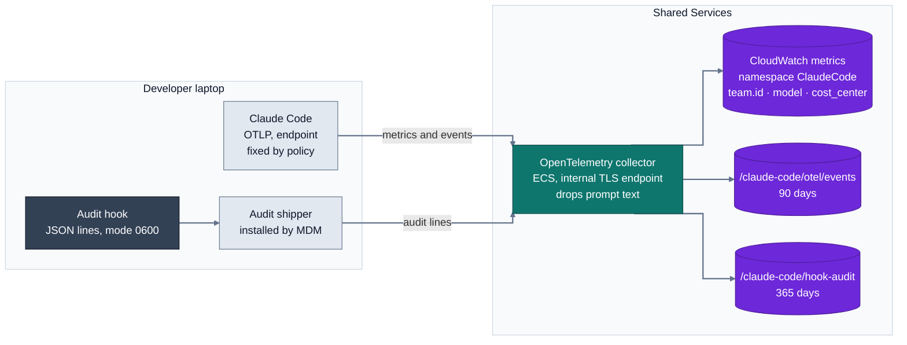

**Measuring honestly.** Telemetry makes it easy to produce numbers. It doesn't make them true. Three habits help.

Say which cost you're quoting. The telemetry metric is Claude Code's own estimate at list price, available in minutes. The bill, filtered by the `Team` tag, is authoritative and hours late. When they disagree, the bill wins, and a report that leaves out cache tokens undercounts.

Don't confuse activity with value. Sessions and lines of code say people use the tool, not that delivery improved. DORA's 2025 report found AI use correlates with higher throughput and lower stability, and METR's randomized trial found experienced developers 19% slower with AI while believing they were 20% faster. So Claude Code's numbers sit next to the delivery metrics the organization already trusts, such as lead time and change failure rate, plus cost per merged pull request and a short developer survey.

Treat friction as a metric. `tool_decision` rejects and `api_error` events show where the policy gets in the way or the quota runs out. A guardrail with many false positives will be worked around, so false positives are counted and fixed like bugs.

## The Agent in the Pipeline

The last place Claude Code runs is the one with nobody at the keyboard: CI. The pilot is a reviewer. On every pull request to an infrastructure repository, Claude Code reviews the change with the platform team's own review skill and posts its findings as comments. With no human watching each step, it gets the same gates as a human change, and a few more.

**Same identity rules: OIDC, an exact subject, one account.**

```yaml
permissions: {} # nothing at workflow level; the job asks for exactly what it uses

jobs:
  review:
    timeout-minutes: 15 # hard stop on runner time, on top of --max-turns and --max-budget-usd
    permissions:
      contents: read # check out the pull request
      pull-requests: write # post inline and summary comments
      id-token: write # GitHub OIDC token for the AWS role
    steps:
      # ...
      - name: AWS credentials (GitHub OIDC, straight into Shared Services)
        uses: aws-actions/configure-aws-credentials@e1253824e5c10ff9df46874f81ed3ec929e19cfd # v6.3.0
        with:
          role-to-assume: ${{ vars.CLAUDE_REVIEW_ROLE_ARN }}
          aws-region: us-east-1
          role-duration-seconds: 3600
          allowed-account-ids: ${{ vars.CLAUDE_REVIEW_ACCOUNT_ID }}
```

The job's token can read the code, comment on the pull request and request an OIDC token, and nothing else. The AWS role is the one from the identity section: an exact `pull_request` subject, one hour, and only the CI reviewer's own inference profile, so its spend lands on its own `Team` tag and budget. The private marketplace is read with a short-lived token from a GitHub App that can read only that repository, the pattern the landing zone uses for private modules. Every action is pinned to a full commit SHA.

**The same policy as a laptop, but tighter.** The action takes Claude Code settings for the run:

```yaml
          settings: |
            {
              "modelOverrides": {
                "claude-sonnet-5-5": "${{ vars.CLAUDE_REVIEW_SONNET_PROFILE_ARN }}"
              },
              "availableModels": ["claude-sonnet-5-5"],
              "env": {
                "CLAUDE_CODE_SUBPROCESS_ENV_SCRUB": "1",
                "CLAUDE_CODE_DISABLE_FEEDBACK_SURVEY": "1"
              },
              "permissions": {
                "defaultMode": "dontAsk",
                "deny": [
                  "Bash(terraform apply *)",
                  "Bash(terraform destroy *)",
                  "Bash(aws *)",
                  "Bash(git push *)",
                  "Bash(gh pr merge *)",
                  "Bash(gh pr review *)",
                  "WebFetch"
                ]
              }
            }
          claude_args: >-
            --model claude-sonnet-5-5
            --max-turns 30
            --max-budget-usd 3
            --allowedTools "Read,Grep,Glob,Skill,Agent,Bash(git diff:*),Bash(git log:*),Bash(git show:*),Bash(gh pr view:*),Bash(gh pr diff:*),Bash(gh pr comment:*),mcp__github_inline_comment__create_inline_comment"
```

Sonnet only: reviews don't need Opus. The tool list allows read commands and the comment tools, and the deny rules are a second lock behind it. The environment scrub keeps the OIDC credentials out of every shell Claude runs. Turns, budget and runner time are capped, so a confused run costs three dollars, not three hundred. And the prompt interpolates only the pull request number, the repository name and the base branch, never the title, body or branch name the author controls. That's prompt injection in CI, and the fix is the same as for script injection.

**Same gates as a human change.** The reviewer comments. It never approves or merges; a human does. It can't push, because the job's token can't write contents. The change still goes through the same static checks, plan and approval on `prod` as any other. The review skill even starts from the AWS article's question: which definitions run this file, so which accounts and regions does it reach?

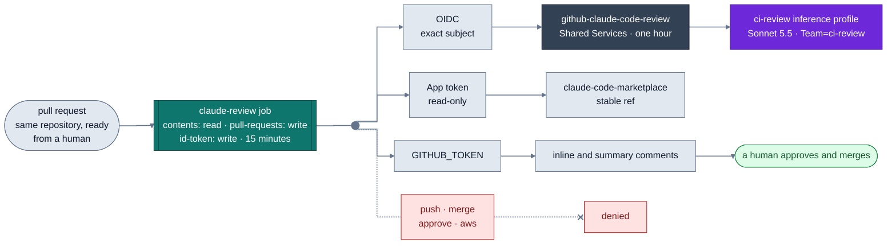

**Why not the Claude GitHub App.** The official app asks for broad repository permissions, including write access to contents and workflows. The action works with the job's own `GITHUB_TOKEN` instead, so comments come from `github-actions` and the only stored secret is the read-only marketplace App key. As with the landing zone's pipeline roles, the identity should match the job, not the most convenient superset.

The pilot repository is `infrastructure-aws-shared-services` itself, the project that holds this Terraform, so if the reviewer gets something wrong, the platform team is the first to know.

## Rolling It Out: Canary First

Nothing in this design is turned on for everyone at once. The rollout follows the rule the pipeline and the modules follow in the AWS article: one consumer first, then the rest, with a decision between each step.

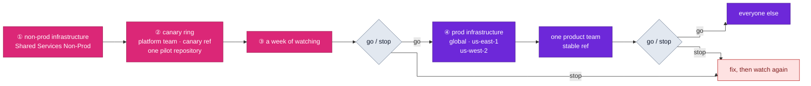

**Non-prod infrastructure first.** Apply the non-prod global definition, then `non-prod/us-east-1`. The platform team's inference profiles, its policy and budget, and the CI reviewer's role now exist in Shared Services Non-Prod.

**Then the canary ring: one team, one repository.** MDM sends the baseline and the platform team's drop-in to their machines. Their AWS profile points at the non-prod account, their marketplace follows `canary`, and the reviewer runs on one repository. The platform team is the right canary for the reason the module repositories were for the pipeline: if something breaks, the people who can fix it notice first.

**A week of watching.** A canary is only as good as what you look at: cost and tokens per team and model, the share of cache reads, throttling errors, rejects, the audit trail, reported false positives, the budget, and the eval suite on every plugin release. It's also where the questions only a live run can answer get settled, such as whether the `Team` tag reaches the Bedrock line items the budgets rely on.

**Then production, in waves.** Apply the prod definitions, global first, then `us-east-1` and `us-west-2`. Then the MDM rings: one product team, then everyone else. Each ring gets the baseline and its own drop-in, and the marketplace's `stable` ref moves to the release the canary ran.

**A go or stop decision per wave.** Each wave starts only when the previous one passes a short, written gate:

- No open guardrail incident, and no reported false positive without a fix or a decision.
- Spend within the budget's forecast, with the telemetry estimate and the bill in rough agreement.
- No sustained throttling, and the quota increase for the next wave already approved.
- The previous wave working without daily requests to the platform team for exceptions.

A failed gate stops the rollout, not the developers already on it. Rollback is boring by design: the previous managed files from MDM, `stable` moved back, or a reverted pull request.

**Training is part of the wave.** A license isn't adoption. Anthropic's study of real Claude Code sessions found verified success around 15% for novices, against 28 to 33% for intermediate users and above. So each wave starts with a short session from the platform team: what the policy blocks and why, how to use the skills, and how to report a false positive. The startup announcement in the managed settings points everyone at the marketplace, so "why was that blocked?" is always one link away.

**Steady state is more of the same.** A new model is a new key in the Terraform `models` map, applied to non-prod first, used by the platform team for a week, then promoted. Nothing reaches everyone without having run somewhere first.

---

## What was validated

Everything this project owns is implemented: the managed settings and the team drop-ins, the marketplace and its three plugins, the Terraform for Shared Services with a definition per environment and region, the CI workflow and the collector configurations. The changes that belong to other landing zone projects are written out but not built here: the permission sets, cost allocation tags and region SCP exception in the management project, the collector's network endpoint and ECS service, and the marketplace's GitHub App. Each piece that is built was checked on 2026-10-12 with the tool meant to check it, and nothing in this list called a model or an AWS API:

- **Facts first.** Where my research disagreed or left something open, I read the official page that day: Claude Code's docs, the Bedrock user guide, the Service Authorization Reference, the GitHub Action's pinned release and the collector's exporter docs.
- **Plugins.** The marketplace and each plugin pass `claude plugin validate --strict`. A negative test showed the validator really checks hooks and MCP configuration, and the first run caught invalid YAML in a skill. `claude plugin tag --dry-run` produced the expected tags, so manifests and catalog agree, and `claude plugin details` measured each plugin's cost in context.
- **Hooks.** The contract tests pass under `sh`, `bash` and `dash`. The shell scripts are clean under ShellCheck, and every Python file compiles under Python 3.9.6. The eval suite's format was checked against the documented tables; the suite itself calls a model, so it runs on release candidates.
- **MCP servers.** A smoke test started both pinned servers with the exact commands the allowlist approves, and listed their tools without calling any.
- **Managed settings.** Every file is valid JSON. `claude doctor`, after a negative test showed it catches bad values, flags only one expected note: `deniedModels` counts only from the managed path, and the check read a copy. `claude auto-mode config` parses the auto mode rules. A consistency script checks the files against each other: the MCP allowlist matches the plugin's commands, both marketplace refs are allowed, every team drop-in maps every model to a profile in an approved account and region, and the inline backstop hook blocks six real invocations and lets four legitimate ones through: two lookalikes, a `terraform plan`, and an apply in CI.
- **Terraform.** It passes `fmt` and `validate`, and `terraform test` against a mocked AWS provider on every definition, with negative runs for a wildcard OIDC subject, an unknown model and a third region. tflint and trivy, with the landing zone's own configurations, find nothing, and a planted `s3:*` on `*` proved trivy scans the generated policies. The landing zone's OPA rules were checked by hand.
- **CI.** The workflow passes actionlint, every input exists in the pinned release of each action, and every pinned SHA is the commit its tag points to.
- **Telemetry.** Both collector configurations pass the collector's own validator, which rejected an unknown exporter key in a negative test.
- **Hygiene.** A secret scan of the whole repository is clean, and a negative test showed it catches a planted key. The only account IDs are the placeholders.

Everything above passed as designed.

What none of this can show is the live behavior: hooks firing inside real sessions, Bedrock answering through the team profiles, which of the two profile ARNs Bedrock puts in `bedrock:InferenceProfileArn`, and the spend landing on the right line of the bill. That's what the first canary proves.

## What's next

This is a living project, and I'm taking it deeper one area at a time, starting with the live canary: one team, one repository, a week of watching, and the first go or stop decision. That's what turns this design from validated into proven.

Then the Claude apps gateway. It answers the two things this design deliberately leaves out, hard per-user spend caps and devices outside MDM, and it brings costs of its own: a PostgreSQL database to keep highly available, OIDC-only sign-in, and features its sessions lose. The approach is the same as in this article: lay out the options and their trade-offs, and add it when the requirements call for it, not before.

After that, agents beyond coding. The same company will want agents that work on tickets, runbooks and data, written by teams other than the platform team. On AWS, that's where Amazon Bedrock AgentCore comes in, and in particular its Policy feature: Cedar rules attached to an AgentCore Gateway and evaluated on every call an agent makes to a tool. It's the idea behind this whole article, a deterministic ceiling around a probabilistic actor, applied to agents the platform team didn't write.
