# How I Think About Enterprise AWS, End to End

*Alan Santillán · October 2026*

In this article, I'll walk you through how I think about designing an enterprise platform on AWS with Terraform. It's a way of thinking I've built over years of doing this kind of work, and it covers the considerations end to end, from the first account to production workloads.

## Contents

- [Environments Are the Easy Part. Boundaries Are the Hard Part.](#environments-are-the-easy-part-boundaries-are-the-hard-part)
- [The Account Is the Boundary](#the-account-is-the-boundary)
- [Which Accounts, and Why](#which-accounts-and-why)
- [Guardrails: Prevent First, Detect Second](#guardrails-prevent-first-detect-second)
- [Identity: No Users, Only Roles](#identity-no-users-only-roles)
- [Terraform: Structure the Code Like You Structured the Accounts](#terraform-structure-the-code-like-you-structured-the-accounts)
- [Pipelines: One Definition, Every Account](#pipelines-one-definition-every-account)
- [Modules: One Repository, One Version](#modules-one-repository-one-version)
- [Shared Services: What Every Team Depends On](#shared-services-what-every-team-depends-on)
- [What was verified](#what-was-verified)
- [What's next](#whats-next)

---

## Environments Are the Easy Part. Boundaries Are the Hard Part.

Think about any application you've worked on. It probably has a dev environment, a staging environment and a production environment. They look alike, but they aren't identical: production often runs more services than the lower environments, and some services only exist there.

Nobody questions that separation. We want developers to move fast in dev without any chance of touching production, and we want production to be boring, locked down and predictable.

AWS needs the same separation, but you have to build it with AWS's own pieces and play by its rules and limits: accounts, permissions, networks, quotas. The fundamentals don't change. Each team should be able to work autonomously inside its own space, without jumping between environments or mixing permissions along the way.

That gives us the frame for everything that follows. Every decision in this article answers one question: how do we keep environments separated, keep security tight, and keep delivery fast, all at the same time?

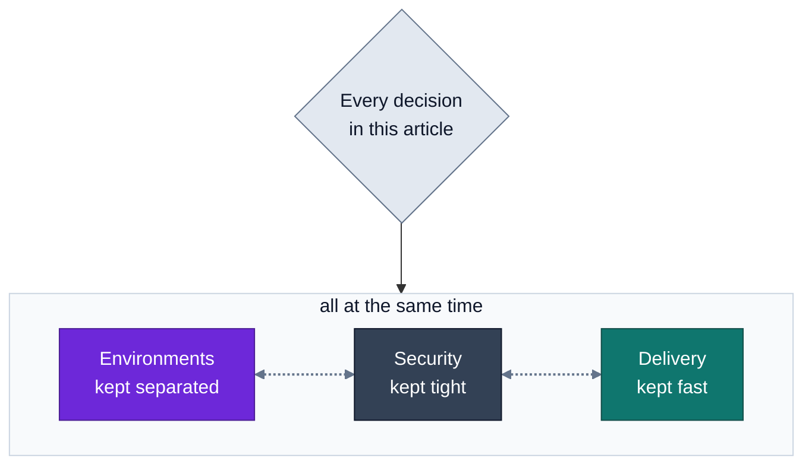

## The Account Is the Boundary

In AWS, the strongest boundary you can draw is the account. Not a VPC, not a tag, not an IAM policy: the account.

An account isolates three things by default. **Permissions**: by default, nothing in one account can touch another unless both sides allow it. **Blast radius**: a mistake, a leaked credential or a runaway script stays contained where it happened. **Cost and quotas**: each account's spend is tracked separately and each account has its own service quotas, so dev can't use up production's.

You can try to get the same result inside a single account with naming conventions, tags and carefully written IAM policies. It works until it doesn't, and you find out the day someone deletes the wrong thing.

So the app environments from the previous section map directly to accounts: one for dev, one for staging, one for production. Separation stops being a convention people have to remember and becomes a wall they can't walk through by accident.

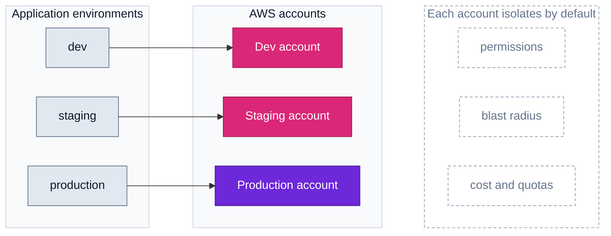

That solves isolation, and creates a new problem: now you have many accounts to govern. That's what AWS Organizations is for.

## Which Accounts, and Why

AWS Organizations turns a pile of accounts into a platform: one hierarchy, one bill, and a place to apply rules once instead of account by account. Those rules are Service Control Policies (SCPs), and they attach to the root, to an Organizational Unit or to an account, and flow down to everything below.

That drives the whole design. An account exists because something needs its own boundary. An OU exists because a group of accounts needs the same rules.

```
Root
├── Management account          (billing, the organization, identity; no workloads)
├── Security OU
│   ├── Log Archive
│   └── Security Tooling
├── Infrastructure OU
│   ├── Prod OU
│   │   ├── Network Prod
│   │   ├── Shared Services Prod
│   │   └── Backups Prod
│   └── Non-Prod OU
│       ├── Network Non-Prod
│       ├── Shared Services Non-Prod
│       └── Backups Non-Prod
├── Workloads OU
│   ├── Prod OU
│   └── Non-Prod OU             (dev, staging)
└── Sandbox OU
```

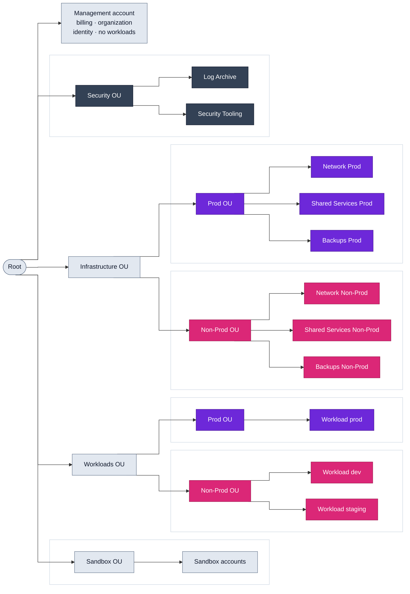

**Prod and non-prod, at every layer.** This is the app analogy from the beginning, applied to the whole platform. The split does two jobs at once. It limits blast radius: nothing that happens in non-prod, whether a mistake, a bad deploy or a leaked credential, can reach production. And it buys speed: because non-prod can't hurt production, I can give teams real autonomy there, with broader permissions, fewer approvals and room to break things. Production gets the opposite treatment: strict SCPs, changes only through pipelines, no experiments. Two kinds of OU, two sets of rules, instead of one policy full of exceptions.

A note on naming, because both sets of words appear from here on. A workload has development, staging and production environments. The platform underneath has two: non-prod and prod. Development and staging are both non-prod, so they run on the non-prod network, use the non-prod shared services and follow the non-prod rules.

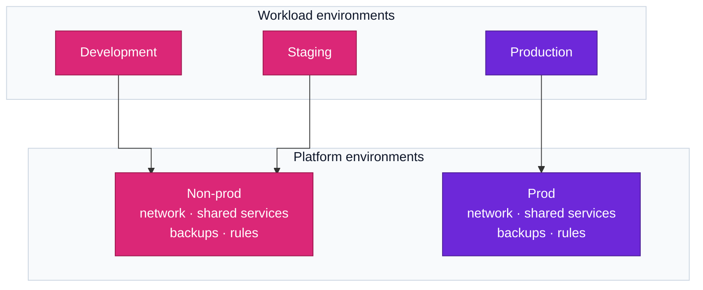

**Management account.** I keep it as close to empty as AWS allows: billing, the organization itself, and the few things that can only live there, such as the IAM Identity Center instance. Their day-to-day administration is delegated to member accounts. SCPs don't apply to this account, so anything running there runs outside your own rules.

**Log Archive.** Every account ships its logs here, and almost nobody can log in. If an account is compromised, the evidence of what happened is somewhere the attacker can't reach.

**Security Tooling.** The security team's home: detection and compliance services for the whole organization are operated from here. They get visibility into every account without needing access to the management account.

**Network.** The network is shared by everything, so a bad change there is the widest blast radius you have. With a separate non-prod network, routing and firewall changes get tested for real before they touch production.

**Shared Services.** The tooling every team depends on: Terraform states, container registries, base images. It is split for the same reason as the network. A broken registry in non-prod is an annoyance; in production it stops every release.

**Backups.** Backups are your last line of defense. If they live next to the workload, whoever compromises the workload can delete them too. In their own account, they survive. Production backups should be impossible to delete, even for an admin; non-prod backups can have shorter retention and looser rules.

**Sandbox.** Disposable accounts with a budget alert and no connection to anything else. People get a place to try things without asking for permission, and nothing they do there can leak into the real environments.

The Security OU is the one place I don't split by environment: its job is to watch all of them from the outside.

## Guardrails: Prevent First, Detect Second

With the structure in place, each OU gets its rules. The tool is the Service Control Policy, and one thing about it is often misunderstood: an SCP never grants anything. It sets the ceiling. Whatever IAM allows inside an account, the SCP above decides whether it's possible at all, and that applies to every user and role in the account, including its root user and its administrators. The only exceptions are service-linked roles and the management account.

That's what makes it a guardrail and not a permission. I don't have to trust that every role in every account was written correctly. Some things simply can't happen.

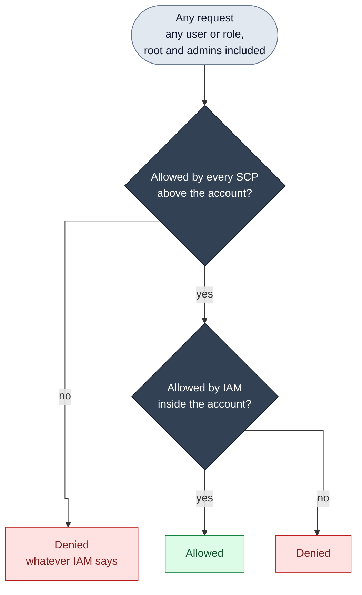

I layer them from the top down:

- **Root:** what is never acceptable in any member account. Leaving the organization. Disabling audit logging or threat detection. Using regions we don't operate in, global services excepted. Using the account's root user.
- **Prod OUs:** stability over freedom. Infrastructure changes only come from the pipeline role: people get read-only access, and the SCP denies the sensitive actions to everything except that role. Backups and their vaults can't be deleted. Network and encryption settings can't be altered from inside a workload account.
- **Non-Prod OUs:** freedom with a floor. The root rules still apply, and little else. This is where teams move fast, so I restrict what would cost real money or weaken security, and leave the rest open.
- **Sandbox OU:** anything goes, inside a box. No connection to the corporate network, no expensive resources, limited regions.

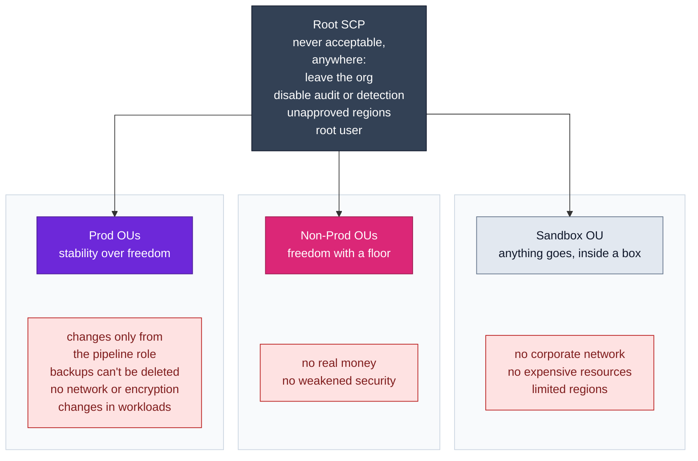

Here is one statement from a typical one, trimmed for space. It blocks the most obvious ways to switch off the security baseline, for everyone except the role that manages it. The real policy denies more actions, and also stops anyone else from creating or changing a role with that name:

```json
{
  "Effect": "Deny",
  "Action": [
    "cloudtrail:StopLogging",
    "cloudtrail:DeleteTrail",
    "guardduty:DeleteDetector",
    "config:StopConfigurationRecorder"
  ],
  "Resource": "*",
  "Condition": {
    "ArnNotLike": {
      "aws:PrincipalArn": "arn:aws:iam::*:role/platform-pipeline"
    }
  }
}
```

This is also where you start playing against AWS's limits. You can attach at most ten SCPs directly to an OU, and each one is capped at 10,240 characters, so you can't write a policy per concern. You end up consolidating, and that forces you to decide what really matters.

SCPs prevent. They don't tell you what is misconfigured inside the lines they draw. That's the job of detection, which lives in the Security accounts and comes later.

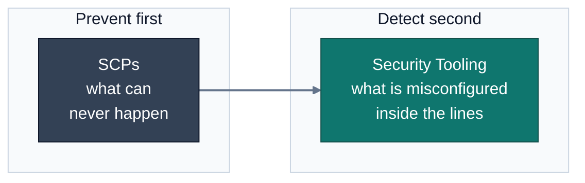

## Identity: No Users, Only Roles

So far we have walls and rules. Now someone has to get in.

My starting point is that no account has IAM users. No long-lived access keys, nothing that can sit in a laptop or a repository for three years waiting to leak. Every access, human or machine, is a role assumed for a limited time.

**Humans come in through IAM Identity Center.** Where the identities live is a choice. Identity Center has its own built-in directory, which is enough to get started or for a small team: you create users and groups directly in AWS. In an enterprise, I connect it to the company's existing identity provider instead, such as Entra ID or Okta, so users and groups are synced automatically and AWS stops being one more place to manage people.

Either way, the experience is the same: people log in once and see the list of AWS accounts and roles they're entitled to. With an external provider there's an extra benefit: when someone leaves the company, disabling their corporate identity cuts off their AWS sign-in along with everything else, with no separate offboarding step to forget. Sessions that are already open run until they expire, a few hours at most.

Access is assigned as a combination of three things: a group, a permission set and an account. The payments team gets developer access in the payments dev account. Nobody is granted anything individually, so the question "who can touch production?" has an answer you can read in one place.

This is where the prod and non-prod split pays off again. The same team gets different permission sets depending on where they are:

- **Non-prod:** broad access. Create, break, delete, try again.
- **Prod:** read-only by default. Enough to investigate an incident, not enough to change anything by hand.

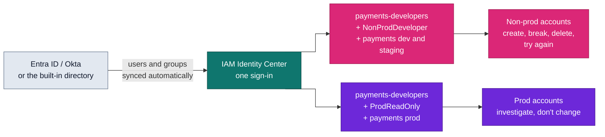

**Machines follow the same idea.** Pipelines don't store AWS credentials. They authenticate through OIDC federation: GitHub signs a token that states which repository, branch and environment the job runs from, and AWS exchanges it for temporary credentials for one role. The production role only trusts the production environment of its repository, and that environment only accepts the main branch. Apart from break-glass, the pipeline is the only way in.

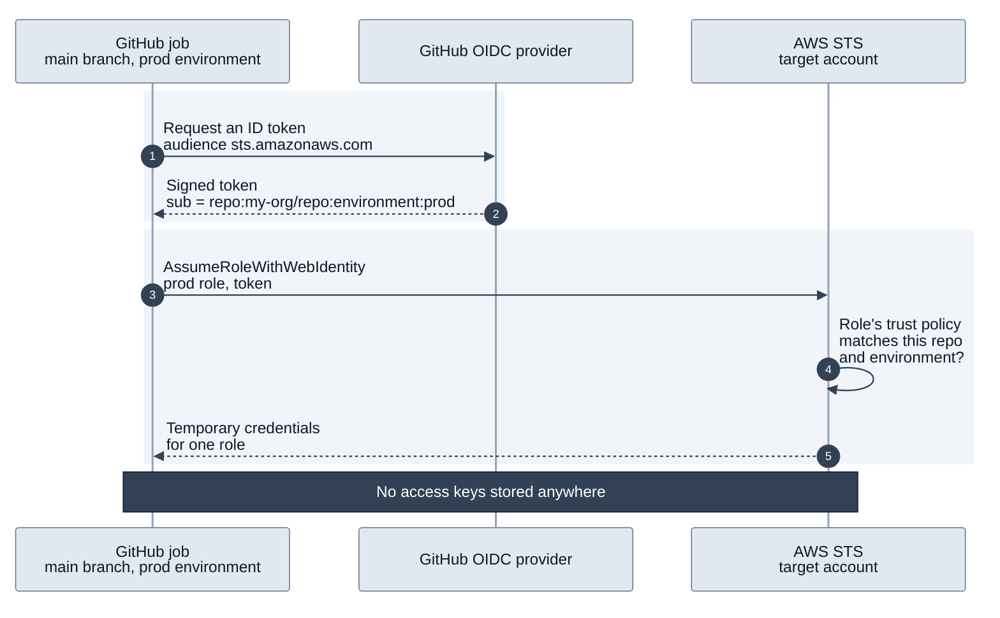

**The first piece of disaster recovery.** Identity is the first place where I stop and ask: what happens if a region goes down? It's the right place to start, because of a simple chain of dependencies. If nobody can log in, nobody can run the recovery plan, however good it is.

Until early 2026, Identity Center lived in a single region and that was a known weak spot. It now supports multi-region natively: you pick additional regions, and it replicates identities, permission sets, assignments and sessions to them automatically. If the primary region has a problem, people switch to the access portal of another region and keep reaching their accounts with the permissions they already had.

It comes with conditions worth knowing before you design around it. It needs an organization instance, a multi-region customer managed KMS key, and either the built-in directory or an external identity provider; Active Directory as a source isn't supported. And with an external provider, check that it supports multiple sign-in endpoints, because not all of them do.

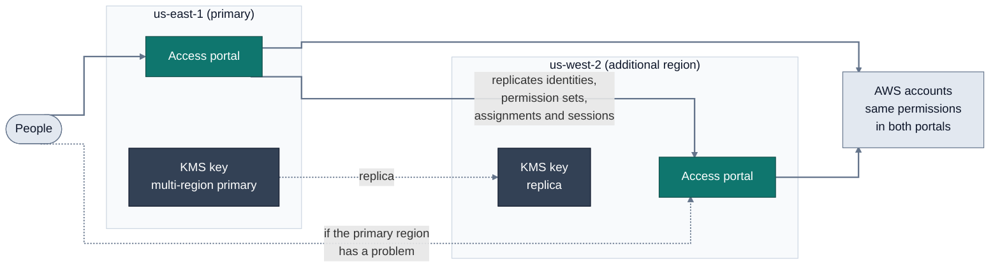

This sets a habit for the rest of the article. For every piece from here on, I'll consider disaster recovery at design time. Turning on replication while you're building costs a few lines of Terraform and very little money. Retrofitting it after an outage, with production already running on top, is a project.

**Break-glass** is the one deliberate exception to the no-users rule: a dedicated emergency account with a couple of users protected by hardware MFA, whose only permission is to assume an emergency role in each account. It doesn't depend on the identity provider or the pipeline, so it works on the day either one is down. It exists, it's tested, and every use of it triggers an alert.

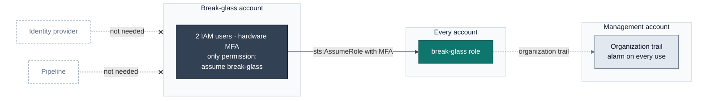

The result is that people rarely need production access at all. That isn't a restriction on the team. It's what lets production stay boring.

## Terraform: Structure the Code Like You Structured the Accounts

Everything up to this point could be clicked together in the console. It shouldn't be. From here on, every piece of the platform is code, so before building anything else I need to decide how that code is organized. The same instincts apply: small blast radius, clear ownership, and no copy-paste between environments.

**State is the blast radius of Terraform.** A single state file for the whole platform means every change, however small, plans against everything, and one bad apply can touch anything. So I split state the same way I split accounts: one state per project, per environment, per region. A change to a dev workload can't even see the production network. The plans are fast, the damage is bounded, and the role that applies each state needs permissions for that slice only.

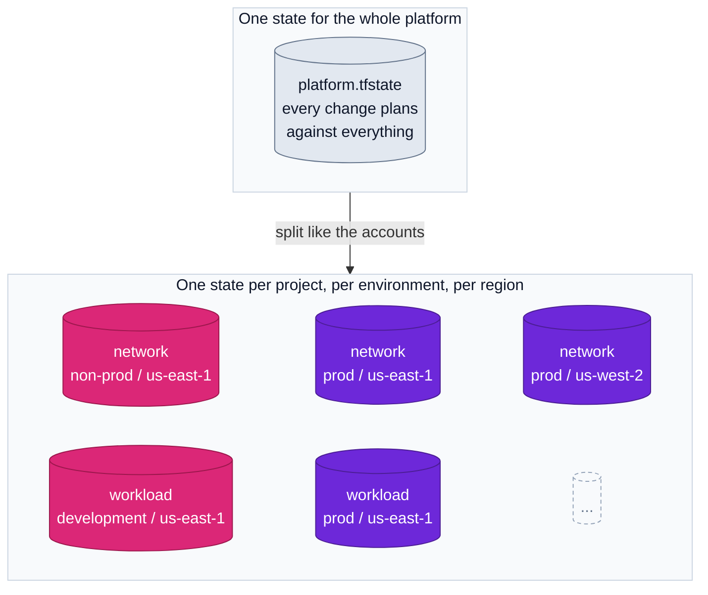

**Projects: one repository each, named after the organization.** The projects mirror the account structure, and each one is its own repository:

```
infrastructure-aws-management
infrastructure-aws-security
infrastructure-aws-logs
infrastructure-aws-network
infrastructure-aws-shared-services
infrastructure-aws-backups
infrastructure-aws-workload
```

Separate repositories give you the boundaries by construction, the same way accounts do:

- **Access is a repository setting.** Who can read, write and approve changes to the network is decided on the network repository. There's no CODEOWNERS file to maintain and trust.
- **Pipelines don't mix.** Each repository has its own GitHub Actions history, its own workflows and its own secrets. A network apply never gets lost among workload deploys.
- **The AWS role trusts one repository.** The role that applies the network can only be assumed from the network repository. The workload repository can't reach it, however its workflows are written.
- **A bad merge stays contained to one project.**

A change that spans several projects means several pull requests, merged in order. I don't count that as a cost: the order is the dependency order between projects, which we'll see in a moment, and the pipeline code itself lives once, in shared reusable workflows.

**DRY: one skeleton, many definitions.** Every repository has the same two folders inside, with a strict rule about what goes in each. If you know your way around one project, you know your way around all of them.

```
infrastructure-aws-network/
├── terraform/                  # the skeleton: logic, written once
│   ├── main.tf
│   ├── variables.tf
│   ├── outputs.tf
│   ├── providers.tf
│   └── versions.tf
└── definitions/                # values only, no logic
    ├── non-prod/
    │   └── us-east-1/
    │       ├── backend.hcl
    │       └── terraform.tfvars
    └── prod/
        ├── us-east-1/
        │   ├── backend.hcl
        │   └── terraform.tfvars
        └── us-west-2/          # DR region
            ├── backend.hcl
            └── terraform.tfvars
```

The `terraform` folder is the skeleton. It describes what the project is, and it has no idea which environment it's running in. The `definitions` folder holds one folder per environment and, inside it, one per region. Each of those contains only two things: where its state lives and the values that make it different.

The pipeline combines them:

```bash
terraform -chdir=terraform init \
  -backend-config=../definitions/prod/us-east-1/backend.hcl

terraform -chdir=terraform plan \
  -var-file=../definitions/prod/us-east-1/terraform.tfvars
```

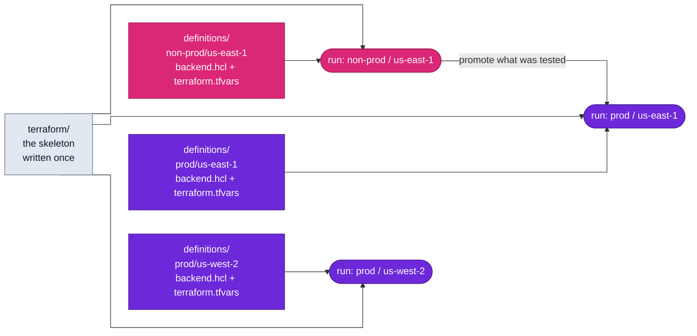

Every environment runs exactly the same code. The difference between non-prod and prod is a short file of values you can read side by side, not two codebases that drift apart. Promotion follows from that: a change is applied to the lower environment first and only then promoted to production, so what reaches production is what was already tested.

This is also where the DR preparation shows up again. The second region is one more folder under `prod`, with its own state and its own values, running the same skeleton. Nothing has to be redesigned to add it, and because its state is separate, an incident in one region can't lock or corrupt the other.

**One project run, one region.** The definitions folder separates regions, but that separation is only real if the code respects it. So the skeleton follows a strict rule: it has a single AWS provider, and that provider's region comes from the definition. No provider alias points at another region, no resource sets a region of its own, and no data source reads from one.

```hcl
# terraform/providers.tf
provider "aws" {
  region = var.region    # set by the definition, never hardcoded
}
```

It's tempting to break this rule, because it's convenient. A second provider aliased to the DR region lets you create a bucket and its replica, or both ends of a peering, in a single apply. Think about what that costs. Every plan now has to call both regions, because by default Terraform refreshes everything in the state before it does anything. If either region is unavailable, the whole run fails, including the part that only concerned the healthy region. You've tied the two regions together at exactly the moment you need them apart.

With one region per run, each state describes one region and nothing else. An outage in us-east-1 can't stop a plan in us-west-2, because that plan never calls us-east-1.

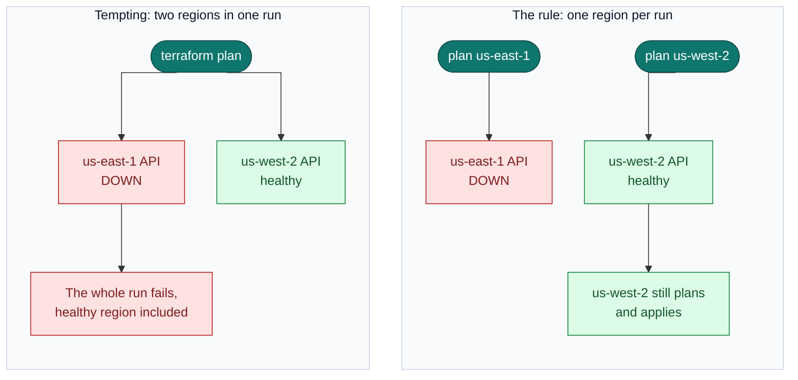

Global services are the exception. The control planes of IAM, Organizations and Route 53 run in a single region, so resources of those services are kept out of the regional states I would need to apply during a failover. I come back to this in the pipelines section.

Some things do span regions: a replicated bucket, or a peering between two Transit Gateways. For those, each region creates its own side from its own definition, and the two sides are joined by a value, not by a live lookup. The primary region's definition receives the ARN of the replica bucket as a plain variable, or builds it from a naming convention. It doesn't ask the other region for it.

```hcl
# definitions/prod/us-east-1/terraform.tfvars
region             = "us-east-1"
replica_bucket_arn = "arn:aws:s3:::app-data-prod-us-west-2"
```

The price is that you apply the two sides separately and in order, destination first. I accept that gladly. It's a little more ceremony on a normal day in exchange for two regions that are truly independent on a bad one.

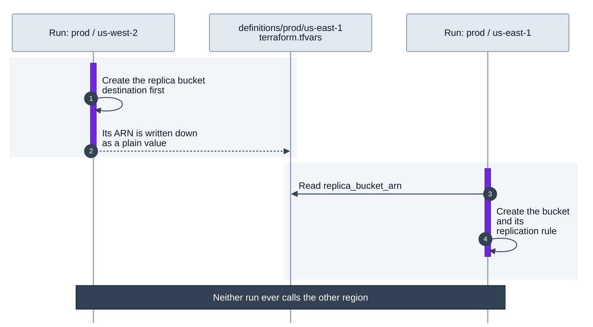

**Outputs: the glue between state files.** Splitting state solves blast radius and creates a new question. When we say "the non-prod environment", we mean a set of things that belong together: a network, shared services, backups, workloads. But in the code they are now separate projects with separate state files. What makes them one environment?

The answer is that they consume each other's outputs. The network project publishes its VPC IDs. The workload project reads them and builds on top. That reading is the glue: it's what turns a collection of independent state files into an environment.

```hcl
# infrastructure-aws-network/terraform/outputs.tf
# The network project publishes its VPCs, by name
output "vpc_ids" {
  value = { for name, vpc in module.vpc : name => vpc.id }
}
```

```hcl
# infrastructure-aws-workload/terraform/network.tf
# The workload skeleton consumes, without knowing which environment it's in
data "terraform_remote_state" "network" {
  backend = "s3"
  config = {
    bucket = var.network_state_bucket
    key    = var.network_state_key
    region = var.region
  }
}

resource "aws_security_group" "app" {
  name   = "app"
  vpc_id = data.terraform_remote_state.network.outputs.vpc_ids[var.vpc_name]
}
```

```hcl
# infrastructure-aws-workload/definitions/staging/us-east-1/terraform.tfvars
# The definition decides where to read from
region               = "us-east-1"
vpc_name             = "workload-staging"
network_state_bucket = "tfstate-network-non-prod-us-east-1"
network_state_key    = "terraform.tfstate"
```

The skeleton says "I need my VPC from my environment's network" and nothing more. Which network that is comes from the definition: the development and staging definitions point at the Network Non-Prod state, and the prod definition points at Network Prod. The code is written once, and the only thing that changes between environments is a few lines of values. A staging workload can't end up attached to the production network by accident, because nothing in its definition points there. The environment boundary we drew with accounts shows up again in the code.

**Dependencies flow in one direction only.** This is the rule that holds everything together. A project can read from the ones that come before it, and never from the ones that come after or sit beside it.


*Dependencies between state files. Purple is production, pink is non-production. The numbers show the order in which the projects are applied. Each arrow means "reads the outputs of".*

Read the diagram from the numbers. Network goes first because it depends on nothing: it creates the VPCs for every environment and publishes their IDs. Shared services comes next: it reads its own VPC from network and publishes the container registry. Backups publishes its vault. The workload goes last, because it reads from all three.

Two things are worth noticing. Every arrow points the same way: the workload reads from the platform, and nothing in the platform reads from the workload. And no arrow crosses colors. The production workload reads only production outputs, while staging and development both read from non-production. Three workload environments sit on top of two platform environments, and the boundary between prod and non-prod holds all the way down.

If the network read from a workload while the workload read from the network, you'd have a loop: neither can be created first, neither can be destroyed first, and rebuilding the environment from scratch becomes impossible. With one direction there's always a valid order to build things. That's also the recovery order. If you had to rebuild an environment from nothing, you would apply 1, 2, 3 and 4 in sequence, and every project would find what it needs already published.

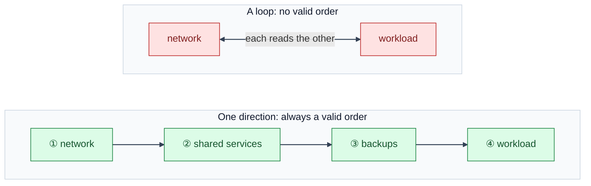

The diagram shows four projects to keep it readable. The management, logs and security projects come before all of them and follow the same rule.

This is where the design starts to feel like a frame. The projects define what exists, the direction of the dependencies defines the order, and the outputs are the joints. Any new piece has an obvious place: it reads from what comes before it and publishes for whatever comes after.

**Shared values live in one central place per environment.** Some services are unique for the whole organization. IPAM is the clearest example: there's one, it serves prod and non-prod alike, and many projects need its pool IDs. Having every project reach into another project's state file for that doesn't scale, and it gives each consumer access to far more than the one value it needs.

For those, I publish the values as parameters in the Shared Services accounts, and which account depends on the value, not on where the service runs. The production pool IDs go to Shared Services Prod. The non-prod pool IDs go to Shared Services Non-Prod. The service is unique, but what it publishes is split by environment.

```hcl
# ipam: publishes each pool into the Shared Services account of its environment
resource "aws_ssm_parameter" "pool_prod" {
  provider = aws.shared_services_prod
  name     = "/platform/ipam/pools/${var.region}"
  type     = "String"
  tier     = "Advanced"    # only advanced parameters can be shared
  value    = aws_vpc_ipam_pool.environment["prod-${var.region}"].id
}

# ...and shares it with the production OUs through AWS RAM
resource "aws_ram_resource_association" "pool_prod" {
  provider           = aws.shared_services_prod
  resource_share_arn = aws_ram_resource_share.parameters_prod.arn
  resource_arn       = aws_ssm_parameter.pool_prod.arn
}

# The non-prod pool is published the same way, into Shared Services Non-Prod.
```

```hcl
# any project: reads from its own environment's Shared Services, by full ARN
locals {
  parameters = "arn:aws:ssm:${var.region}:${var.shared_services_account_id}:parameter"
}

data "aws_ssm_parameter" "ipam_pool" {
  name = "${local.parameters}/platform/ipam/pools/${var.region}"
}
```

There's a detail here that's easy to get wrong. A parameter in another account can't be read by its name alone. It has to be an advanced parameter, shared through AWS RAM with the OUs of its environment, and the consumer asks for it by its full ARN.

The two provider aliases on the publishing side point at different accounts in the same region, so the one-region rule still holds. Each one is its own direct login from the pipeline, not a hop from the first.

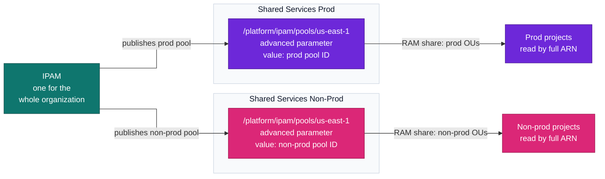

Two things come out of this. A non-prod project never reads anything from a production account, so the environment boundary holds even for shared values. And the parameter has the same path on both sides, so the consuming code is identical in every environment: the only thing its definition supplies is the account ID of its own Shared Services.

The parameter name becomes a stable contract. The team that owns IPAM can refactor its code or move its state, and as long as the parameter keeps its name, nobody downstream notices.

**Pipelines and modules.** The skeleton of each project is built from versioned modules, and it's applied by a pipeline that nobody bypasses in normal operation: no one applies from a laptop. Both are big enough to get their own sections, which come next.

**Disaster recovery.** Beyond the DR folder in the definitions, two things. The state files live in versioned, encrypted buckets, kept in the same region as what they describe and replicated to the other one, because losing state during an outage turns a recovery into archaeology. And the code is the recovery plan: if the platform is fully described in Terraform, rebuilding it in another region is running pipelines in the order the dependencies already define, not following a runbook from memory.

## Pipelines: One Definition, Every Account

We have the code organized. Now something has to run it, and that raises five questions. How does a pipeline get into an AWS account without stored credentials? What is it allowed to do once it's inside? How does it reach its state, and other projects' states, when they live in another account? How do we avoid writing the same pipeline in every repository? And what does it check before it changes anything?

### How does the pipeline get in?

Each job authenticates with OIDC, straight into the account it's going to work on. GitHub issues a short-lived token that says which repository and which environment the job is running from. The target account has a role that trusts that exact origin, and the job assumes it. No access keys are stored anywhere.

The important word is *straight*. A common design has the pipeline enter a central "deployment" account first and hop from there into the others. I avoid that role chaining, for two reasons.

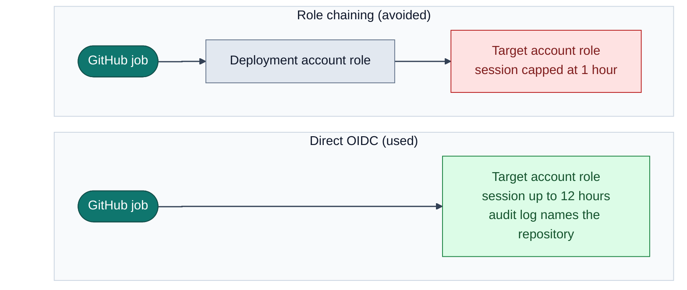

**Session limits.** When one role assumes another, AWS caps the resulting session at one hour, and no setting can raise it. That sounds like plenty until you remember what Terraform actually waits for. Creating or upgrading a database, restoring a snapshot, building a cluster, or deleting the subnets and security groups that a VPC-attached Lambda function was using can each take a long time on their own, and a single apply often does several of them.

If the credentials expire in the middle, the apply doesn't fail cleanly. AWS keeps creating the resource, but Terraform can no longer see it finish, so the state doesn't record what really exists. The state lock can't be released either, because releasing it needs the same credentials that just expired. The pipeline ends in an error, and someone has to step in: unlock the state by hand, work out what was created and what wasn't, and import or clean up before the next run can pass. That manual intervention, on production, in the middle of a change, is exactly what the pipeline exists to avoid.

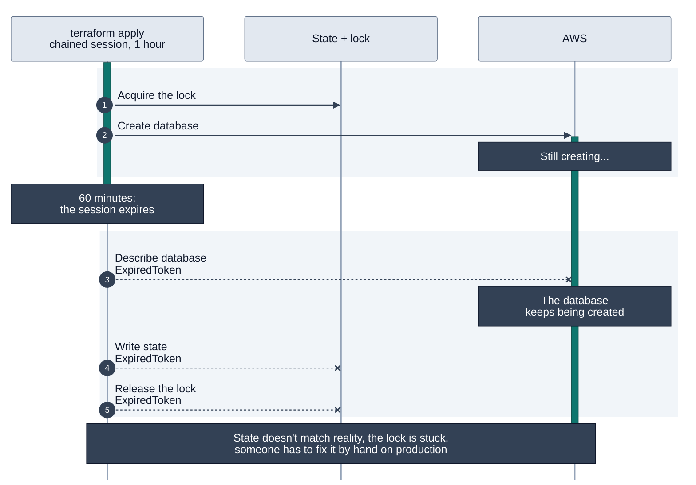

With direct access there is no chain, so the session can last as long as the role allows, up to twelve hours. I set it to comfortably cover the slowest operation the project performs. That takes two settings, and both default to one hour: the role's maximum session duration, and the duration the workflow asks for.

**Traceability.** With direct access, the login event in each account's audit log carries the repository and environment that made the change, not a generic intermediate role that every pipeline shares.

So every account has its own trust relationship with GitHub. This is the trust policy of the role that applies the production network:

```json
{
  "Effect": "Allow",
  "Action": "sts:AssumeRoleWithWebIdentity",
  "Principal": {
    "Federated":
      "arn:aws:iam::111111111111:oidc-provider/token.actions.githubusercontent.com"
  },
  "Condition": {
    "StringEquals": {
      "token.actions.githubusercontent.com:aud":
        "sts.amazonaws.com",
      "token.actions.githubusercontent.com:sub":
        "repo:my-org/infrastructure-aws-network:environment:prod"
    }
  }
}
```

Read the last condition carefully, because it does a lot of work. This role can only be assumed by a job from the network repository running in the prod environment. That environment is configured in GitHub to accept only the main branch and to require an approval. So the approval isn't a step in a workflow file that someone could edit out. GitHub won't start a job in that environment from another branch or without the approval, and a job that skips the environment gets a token the role doesn't trust, so AWS turns it away. For that to hold, administrator bypass is disabled on the environment, and the branch names themselves are protected.

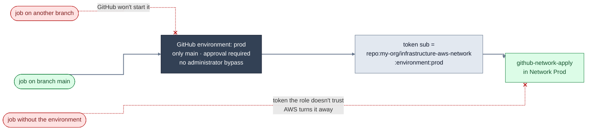

One practical note on that subject value. GitHub changed its format in 2026: repositories created after July 15, 2026 send a subject that also carries the numeric IDs of the owner and the repository. Print a token from your own repository and match what it actually sends.

### What can the pipeline do once it's in?

Getting in is half of the answer. The other half is what the role can do, and it's worth being precise, because "the pipeline role" tends to end up as an administrator by default.

Each project has two roles in each account it deploys to:

- **A plan role**, used on pull requests. It can read, including the state, so it's still sensitive. The only thing it writes is the state lock.
- **An apply role**, used after a merge. It can change what the project owns, and nothing else.

Let's follow one of them all the way through: the apply role of the workload project in a non-prod account. It needs four separate things.

1. **Its own state.** It reads and writes its own state file, and it creates and deletes the lock that stops two runs from colliding.
2. **Other projects' states.** It reads, and only reads, the states it depends on. In our diagram, that's network, shared services and backups.
3. **The encryption keys** for both of the above, since every state bucket is encrypted.
4. **The resources themselves.** Everything above is only about state. To actually apply, the role needs permission to create and modify what the project manages.

```mermaid
%%{init: {"flowchart": {"curve": "stepAfter", "nodeSpacing": 40, "rankSpacing": 60, "wrappingWidth": 320}}}%%
flowchart LR
    scp["SCPs<br/>what nobody in the<br/>account may do"]
    role["github-workload-apply<br/>workload non-prod account"]

    p1["read and write<br/>create and delete the lock"]
    p2["read only"]
    p3["decrypt<br/>generate data key"]
    p4["create and modify<br/>within its slice"]

    own["① its own state"]
    deps["② network, shared services<br/>and backups states"]
    keys["③ the state encryption keys"]
    res["④ ECS · DynamoDB · load balancers · logs<br/>security groups · roles with a boundary"]

    scp -. "ceiling" .-> role
    role --> p1 --> own
    role --> p2 --> deps
    role --> p3 --> keys
    role --> p4 --> res

    classDef security fill:#334155,stroke:#0f172a,color:#ffffff
    classDef nonprod fill:#db2777,stroke:#9d174d,color:#ffffff
    classDef allowed fill:#dcfce7,stroke:#15803d,color:#14532d
    classDef neutral fill:#e2e8f0,stroke:#64748b,color:#0f172a
    class scp security
    class role nonprod
    class p1,p2,p3,p4 allowed
    class own,deps,keys,res neutral
```

The first three look like this. To keep it short, the policy shows only the network as a dependency:

```json
{
  "Version": "2012-10-17",
  "Statement": [
    {
      "Sid": "ListStateBuckets",
      "Effect": "Allow",
      "Action": "s3:ListBucket",
      "Resource": [
        "arn:aws:s3:::tfstate-workload-non-prod-us-east-1",
        "arn:aws:s3:::tfstate-network-non-prod-us-east-1"
      ]
    },
    {
      "Sid": "ReadWriteOwnState",
      "Effect": "Allow",
      "Action": ["s3:GetObject", "s3:PutObject"],
      "Resource":
        "arn:aws:s3:::tfstate-workload-non-prod-us-east-1/*"
    },
    {
      "Sid": "OwnStateLock",
      "Effect": "Allow",
      "Action": ["s3:GetObject", "s3:PutObject", "s3:DeleteObject"],
      "Resource":
        "arn:aws:s3:::tfstate-workload-non-prod-us-east-1/*.tflock"
    },
    {
      "Sid": "ReadNetworkState",
      "Effect": "Allow",
      "Action": "s3:GetObject",
      "Resource":
        "arn:aws:s3:::tfstate-network-non-prod-us-east-1/*"
    },
    {
      "Sid": "StateEncryption",
      "Effect": "Allow",
      "Action": ["kms:Decrypt", "kms:GenerateDataKey"],
      "Resource": [
        "arn:aws:kms:us-east-1:333333333333:key/<workload-state-key>",
        "arn:aws:kms:us-east-1:333333333333:key/<network-state-key>"
      ]
    }
  ]
}
```

Notice the asymmetry. On its own state the role can write. On the network state it has `GetObject` and nothing more.

The fourth part is where the real decision is. The easy option is to attach administrator access and move on. I don't, for the same reason I split state: the role should match the slice it's responsible for. The workload apply role can manage the services the workload uses. It can't touch the network, the organization or the security tooling, because those aren't its job.

```json
{
  "Version": "2012-10-17",
  "Statement": [
    {
      "Sid": "ManageWorkloadServices",
      "Effect": "Allow",
      "Action": [
        "ecs:*",
        "rds:*",
        "elasticloadbalancing:*",
        "logs:*",
        "ec2:*SecurityGroup*"
      ],
      "Resource": "*"
    },
    {
      "Sid": "CreateRolesOnlyWithBoundary",
      "Effect": "Allow",
      "Action": [
        "iam:CreateRole",
        "iam:AttachRolePolicy",
        "iam:PutRolePolicy"
      ],
      "Resource": "arn:aws:iam::222222222222:role/workload-*",
      "Condition": {
        "StringEquals": {
          "iam:PermissionsBoundary":
            "arn:aws:iam::222222222222:policy/workload-boundary"
        }
      }
    }
  ]
}
```

The list of services is an example and changes per project. The second statement is the one to keep. A pipeline that can create IAM roles can create a role more powerful than itself, unless you stop it. The condition forces every role it creates to carry a permissions boundary, so a role the pipeline creates can never have more than the boundary allows. The full policy also limits which roles it can pass to a service, and doesn't let it edit or remove the boundary.

```mermaid
%%{init: {"flowchart": {"curve": "stepAfter", "nodeSpacing": 40, "rankSpacing": 60, "wrappingWidth": 320}}}%%
flowchart LR
    pipe["workload apply role"]
    c1["iam:CreateRole<br/>only with workload-boundary"]
    new["workload-* role"]
    cap["never more than<br/>workload-boundary"]
    c2["edit or remove the boundary"]
    bnd["workload-boundary"]

    pipe --> c1 --> new
    new -. "effective permissions =<br/>its policies ∩ the boundary" .-> cap
    pipe --> c2 --x bnd

    classDef nonprod fill:#db2777,stroke:#9d174d,color:#ffffff
    classDef neutral fill:#e2e8f0,stroke:#64748b,color:#0f172a
    classDef allowed fill:#dcfce7,stroke:#15803d,color:#14532d
    classDef denied fill:#fee2e2,stroke:#b91c1c,color:#7f1d1d
    classDef ghost fill:none,stroke:#94a3b8,stroke-dasharray:4 3,color:#64748b
    class pipe nonprod
    class new neutral
    class cap allowed
    class bnd denied
    class c1,c2 ghost
```

The plan role is the same picture with the write access removed: read-only on the account's resources and read-only on the states. It keeps the lock statement, because a plan takes the lock too.

And above all of this sit the SCPs from the guardrails section. The role's policy says what the pipeline may do. The SCP says what nobody in the account may do, the pipeline included.

### How does it reach the states?

The policy above lets the workload role ask for two states, its own and the network's. Neither is in the workload account. As we'll see in the shared services section, every state lives in the Shared Services account of its environment, kept apart from the resources it describes.

So the pipeline applies in one account and keeps its state in another, and across accounts, asking isn't enough. Both sides have to agree. The role's policy allows the request, and the bucket has to allow the caller. This is the policy on the network project's state bucket:

```json
{
  "Version": "2012-10-17",
  "Statement": [
    {
      "Sid": "OwnerReadsAndWrites",
      "Effect": "Allow",
      "Action": ["s3:GetObject", "s3:PutObject"],
      "Principal": {
        "AWS": "arn:aws:iam::444444444444:role/github-network-apply"
      },
      "Resource":
        "arn:aws:s3:::tfstate-network-non-prod-us-east-1/*"
    },
    {
      "Sid": "DependentsOnlyRead",
      "Effect": "Allow",
      "Action": "s3:GetObject",
      "Principal": {
        "AWS": [
          "arn:aws:iam::222222222222:role/github-workload-plan",
          "arn:aws:iam::222222222222:role/github-workload-apply"
        ]
      },
      "Resource":
        "arn:aws:s3:::tfstate-network-non-prod-us-east-1/*"
    }
  ]
}
```

Two statements, trimmed to one owner and one dependent, and they tell the story of this state. The network project owns it and can write to it. The workload depends on it and can only read. The full policy also covers listing the bucket and the lock file, and the policy of the bucket's encryption key has to allow the same roles. That last piece is the one most often forgotten, and the error it produces looks like an S3 problem.

This is how we work across accounts without chaining roles. The job assumes one role, once, in the account it deploys to. From that same session, Terraform reads and writes its state directly in the Shared Services bucket, and S3 allows it because the bucket policy names that role. The pipeline never assumes a role in Shared Services. What crosses the account boundary is a permission on a resource, not an identity.

```mermaid
%%{init: {"flowchart": {"curve": "stepAfter", "nodeSpacing": 30, "rankSpacing": 60, "wrappingWidth": 320, "subGraphTitleMargin": {"top": 0, "bottom": 24}}}}%%
flowchart TB
    subgraph wl["Workload Development<br/>222222222222"]
        job["pipeline job<br/>assumes github-workload-apply, once"]
    end
    subgraph ss["Shared Services Non-Prod<br/>333333333333"]
        direction LR
        norole["any role<br/>in this account"]
        b1[("tfstate-workload-non-prod-us-east-1<br/>bucket policy:<br/>workload apply may write")]
        b2[("tfstate-network-non-prod-us-east-1<br/>bucket policy:<br/>workload may only read")]
        k["state KMS keys<br/>key policies allow<br/>the same roles"]
    end

    job -. "never assumes" .-x norole
    job -- "read and write" --> b1
    job -- "read only" --> b2
    job -- "decrypt and encrypt" --> k

    classDef nonprod fill:#db2777,stroke:#9d174d,color:#ffffff
    classDef neutral fill:#e2e8f0,stroke:#64748b,color:#0f172a
    classDef denied fill:#fee2e2,stroke:#b91c1c,color:#7f1d1d
    class job nonprod
    style job stroke-width:2px
    class b1,b2,k neutral
    class norole denied
    style wl fill:#f8fafc,stroke:#cbd5e1,color:#0f172a
    style ss fill:#f8fafc,stroke:#cbd5e1,color:#0f172a
    linkStyle 0 stroke:#b91c1c,stroke-width:1.5px
    linkStyle 1,2,3 stroke:#64748b,stroke-width:1.5px
```

Now look at who appears in those bucket policies, all of them side by side in one account, and you'll recognize the dependency diagram:

- The network state can be read by shared services and by workloads.
- The shared services state can be read by workloads.
- The backups state can be read by workloads.
- The workload state can be read by nobody.
- Non-prod roles appear only in non-prod buckets, and prod roles only in prod buckets.

```mermaid
%%{init: {"flowchart": {"curve": "stepBefore", "nodeSpacing": 40, "rankSpacing": 60}}}%%
flowchart LR
    subgraph readers["Who may read (bucket policies)"]
        direction TB
        rss["shared services<br/>roles"]
        rwl["workload<br/>roles"]
    end
    subgraph states["States in Shared Services"]
        direction TB
        sn[("network state")]
        sss[("shared services state")]
        sb[("backups state")]
        sw[("workload state<br/>read by nobody")]
    end

    rss -- "read" --> sn
    rwl -- "read" --> sn
    rwl -- "read" --> sss
    rwl -- "read" --> sb

    classDef accent fill:#0f766e,stroke:#134e4a,color:#ffffff
    classDef neutral fill:#e2e8f0,stroke:#64748b,color:#0f172a
    classDef denied fill:#fee2e2,stroke:#b91c1c,color:#7f1d1d
    class rss,rwl accent
    class sn,sss,sb neutral
    class sw denied
    style readers fill:#f8fafc,stroke:#cbd5e1,color:#0f172a
    style states fill:#f8fafc,stroke:#cbd5e1,color:#0f172a
```

The one-direction rule is no longer a convention in the code. It's enforced by permissions. A project that tried to read against the direction of the arrows, or a non-prod pipeline that pointed at a production state, would get access denied.

### How do we avoid writing this pipeline seven times?

Every infrastructure repository needs the same pipeline: check, plan, review, apply. If each one carried its own copy, they would drift within a month, and a security fix would mean seven pull requests.

So the pipeline lives in one central repository, as reusable workflows, and it's versioned like a module: semantic release, a changelog, and version tags. Each infrastructure repository contains only a few lines that call it at a pinned version.

```yaml
# infrastructure-aws-network/.github/workflows/terraform.yml
name: terraform
on:
  pull_request:
  push:
    branches: [development, main]
  workflow_dispatch:
    inputs:
      region:
        description: Run a single region
        required: false

jobs:
  terraform:
    uses: my-org/infrastructure-workflows/.github/workflows/terraform.yml@v3.2.0
    permissions:
      id-token: write
      contents: read
      pull-requests: write
```

```mermaid
%%{init: {"flowchart": {"curve": "stepAfter", "nodeSpacing": 40, "rankSpacing": 60, "wrappingWidth": 360}}}%%
flowchart LR
    canary["non-critical repository<br/>tries the new version first"]
    subgraph pinned[" "]
        direction TB
        net["infrastructure-aws-network"]
        ss["infrastructure-aws-shared-services"]
        bk["infrastructure-aws-backups"]
        wl["infrastructure-aws-workload"]
    end
    wf[["my-org/infrastructure-workflows/terraform.yml<br/>semantic release · changelog · tags<br/>v3.2.0 · v3.1.0 · v3.0.0"]]

    canary -- "@v3.3.0" --> wf
    net -- "@v3.2.0" --> wf
    ss -- "@v3.2.0" --> wf
    bk -- "@v3.2.0" --> wf
    wl -- "@v3.2.0" --> wf

    classDef accent fill:#0f766e,stroke:#134e4a,color:#ffffff
    classDef neutral fill:#e2e8f0,stroke:#64748b,color:#0f172a
    class wf accent
    class canary,net,ss,bk,wl neutral
    style pinned fill:#f8fafc,stroke:#cbd5e1,color:#0f172a
    linkStyle 0 stroke:#0f766e,stroke-width:2px
    linkStyle 1,2,3,4 stroke:#64748b,stroke-width:1.5px
```

The pipeline gets the same treatment as everything else in this design. It's defined once, it has a version you can trust, and a new version is tried on a non-critical repository before the rest move to it. It's the DRY principle again, applied to the thing that runs the code.

### What does the pipeline check before it plans?

A plan tells you what will change. It doesn't tell you whether the change is a good idea. So before any plan runs, the central workflow runs static checks on the code:

- **Formatting and validation**, so reviews are about substance and not style.
- **Linting**, to catch deprecated arguments and provider mistakes.
- **Security scanning**, to catch things like an unencrypted bucket or a security group open to the world.
- **Policy checks**, for the organization's own rules, such as mandatory tags or allowed regions.

```mermaid
%%{init: {"flowchart": {"curve": "stepAfter", "nodeSpacing": 40, "rankSpacing": 60, "wrappingWidth": 360}}}%%
flowchart LR
    pr(["Pull request"])
    subgraph checks["Checks before the plan"]
        direction LR
        fmt[["Format and validate"]]
        lint[["Lint"]]
        sec[["Security scan"]]
        pol[["Policy checks<br/>tags · regions · one region per run"]]
    end
    plan["Plan<br/>posted on the pull request"]

    pr --> fmt --> lint --> sec --> pol --> plan

    classDef accent fill:#0f766e,stroke:#134e4a,color:#ffffff
    classDef neutral fill:#e2e8f0,stroke:#64748b,color:#0f172a
    class fmt,lint,sec,pol accent
    class pr,plan neutral
    style checks fill:#f8fafc,stroke:#cbd5e1,color:#0f172a
    linkStyle 0,1,2,3,4 stroke:#64748b,stroke-width:1.5px
```

Because the checks live in the central workflow, every repository gets the same ones, and adding a new rule for the whole organization is one release. The one-region rule is also enforced here: a policy check fails the pull request if a skeleton declares a provider for a second region or hardcodes one.

### The flow, end to end

A change only ever moves in one direction, from a branch where it's cheap to be wrong to a branch where it isn't. How many steps that takes depends on how many environments the project has.

**Projects with three environments: workloads**

```
feature branch ──► development ──► release/x.y ──► main
                        │               │            │
                        ▼               ▼            ▼
                   development       staging     production
```

```mermaid
%%{init: {"gitGraph": {"mainBranchName": "main", "mainBranchOrder": 3, "showCommitLabel": true, "rotateCommitLabel": false, "showBranches": true}, "themeVariables": {"primaryColor": "#ffffff", "git0": "#64748b", "git1": "#9d174d", "git2": "#db2777", "git3": "#6d28d9", "gitBranchLabel0": "#ffffff", "gitBranchLabel1": "#ffffff", "gitBranchLabel2": "#ffffff", "gitBranchLabel3": "#ffffff", "commitLabelColor": "#0f172a", "commitLabelBackground": "#ffffff", "commitLabelFontSize": "13px"}}}%%
gitGraph
    commit id: "main"
    branch development order: 1
    checkout development
    commit id: "dev"
    branch feature order: 0
    checkout feature
    commit id: "change"
    checkout development
    merge feature id: "apply: development"
    branch release-1.4 order: 2
    checkout release-1.4
    commit id: "apply: staging"
    checkout main
    merge release-1.4 id: "approval, apply: prod"
```

*In the real repositories the release branch is named `release/1.4`.*

1. **Pull request into development.** The static checks run, and then a plan against the development environment, using the plan role. The result is posted on the pull request.
2. **Merge to development.** The change is applied to development automatically. This is the environment where things are allowed to break, and where a team finds out whether an idea works at all.
3. **Release branch.** When a set of changes is ready, a `release/x.y` branch is cut from development. Creating it applies the release to staging.
4. **Merge to main.** Once the release has been validated in staging, it's merged to main. Production waits for the approval on the prod environment and then applies.

**Projects with two environments: network, shared services, backups**

```
feature branch ──► development ──► main
                        │            │
                        ▼            ▼
                    non-prod     production
```

```mermaid
%%{init: {"gitGraph": {"mainBranchName": "main", "mainBranchOrder": 2, "showCommitLabel": true, "rotateCommitLabel": false, "showBranches": true}, "themeVariables": {"primaryColor": "#ffffff", "git0": "#64748b", "git1": "#9d174d", "git2": "#6d28d9", "gitBranchLabel0": "#ffffff", "gitBranchLabel1": "#ffffff", "gitBranchLabel2": "#ffffff", "commitLabelColor": "#0f172a", "commitLabelBackground": "#ffffff", "commitLabelFontSize": "13px"}}}%%
gitGraph
    commit id: "main"
    branch development order: 1
    checkout development
    commit id: "dev"
    branch feature order: 0
    checkout feature
    commit id: "change"
    checkout development
    merge feature id: "apply: non-prod"
    checkout main
    merge development id: "approval, apply: prod"
```

The platform projects only have non-prod and prod, so there's no release branch. Merging to development applies to non-prod, and merging to main applies to production after the approval. The checks, the roles and the approval are the same. There's just one step fewer.

**Staging is production's twin.** This is the rule that makes the whole flow worth trusting. Staging is always kept identical to production: the same skeleton, the same module versions, the same topology and the same configuration. The only differences are the ones that can't be avoided, such as account IDs and names. Development can be smaller, cheaper and rougher. Staging can't.

The reason is what staging is for. It's the last solid validation before a change is promoted, and a validation is only as good as its resemblance to the real thing. If staging has one availability zone and production has three, or staging skips the encryption that production enforces, then a green staging tells you about staging. Every difference between the two is a place where production can surprise you.

It also means that what reaches production is exactly what was validated. The release branch that passed in staging is the one merged to main, with nothing added along the way.

**Changes enter through one door.** Long-lived branches have a known failure: someone fixes something directly on release or main, and the branches quietly stop matching. So the rule is that every change starts in development and moves forward from there. The one exception is an urgent fix to production, and it comes with an obligation: the same fix goes back into development at the same time, so the next release doesn't undo it.

**The branches are part of the security model.** Remember the trust policy from earlier, where the role checked which GitHub environment the job was running in. Each environment only accepts jobs from its own branch:

- The development and non-prod environments accept the development branch.
- The staging environment accepts `release/*` branches.
- The prod environment accepts main, and requires an approval.

```mermaid
%%{init: {"flowchart": {"curve": "linear", "nodeSpacing": 40, "rankSpacing": 60}}}%%
flowchart LR
    subgraph gb["GitHub branches"]
        bd("development<br/>branch")
        bf("feature<br/>branch")
        br("release/*<br/>branches")
        bm("main<br/>branch")
    end
    subgraph ge["GitHub environments"]
        ed["development / non-prod<br/>environments"]
        y1["#nbsp;<br/>#nbsp;"]
        es["staging environment"]
        ep["prod environment<br/>approval required"]
    end
    subgraph ga["AWS roles"]
        rd["apply roles in<br/>non-prod accounts"]
        y2["#nbsp;<br/>#nbsp;"]
        rs["apply role in<br/>the staging account"]
        rp["apply roles in<br/>prod accounts"]
    end
    bd --> ed --> rd
    bf ~~~ y1 ~~~ y2
    bf ~~~ y1
    br ~~~ y1
    br ~~~ es
    br --> es --> rs
    br ~~~ es
    bm ~~~ ep
    bm --> ep --> rp
    bm ~~~ ep
    bf -. "rejected" .-x es
    bf ~~~ es
    br -. "rejected" .-x ep
    classDef prod fill:#6d28d9,stroke:#4c1d95,color:#ffffff
    classDef nonprod fill:#db2777,stroke:#9d174d,color:#ffffff
    classDef neutral fill:#e2e8f0,stroke:#64748b,color:#0f172a
    classDef spacer fill:none,stroke:none,color:transparent
    class ep,rp prod
    class ed,rd,es,rs nonprod
    class bd,bf,br,bm neutral
    class y1,y2 spacer
    linkStyle 14,16 stroke:#b91c1c
    style gb fill:#f8fafc,stroke:#cbd5e1,color:#0f172a
    style ge fill:#f8fafc,stroke:#cbd5e1,color:#0f172a
    style ga fill:#f8fafc,stroke:#cbd5e1,color:#0f172a
```

So a feature branch can't apply to staging, and a release branch can't apply to production. It isn't a convention that the team agrees to follow. GitHub only lets the right branch into each environment, and AWS refuses the role to any job that isn't running in it.

Put the layers side by side and you can see how a bad change gets stopped. The static checks catch it before it's planned. The lower environment catches it when it's applied for the first time. Staging catches it under production conditions. The role's policy stops it if it's outside the project's slice. And the SCP stops it if it should never happen at all.

```mermaid
%%{init: {"flowchart": {"curve": "stepAfter", "nodeSpacing": 40, "rankSpacing": 60}}}%%
flowchart LR
    bad(["A bad change"]) --> l1["Static checks<br/>before it's<br/>planned"]
    l1 --> l2["Lower<br/>environment<br/>first real apply"]
    l2 --> l3["Staging<br/>production<br/>conditions"]
    l3 --> l4["Role's policy<br/>outside the<br/>project's slice"]
    l4 --> l5["SCP<br/>should never<br/>happen at all"]
    l5 --> prod["Production"]

    classDef prod fill:#6d28d9,stroke:#4c1d95,color:#ffffff
    classDef nonprod fill:#db2777,stroke:#9d174d,color:#ffffff
    classDef security fill:#334155,stroke:#0f172a,color:#ffffff
    classDef neutral fill:#e2e8f0,stroke:#64748b,color:#0f172a
    classDef denied fill:#fee2e2,stroke:#b91c1c,color:#7f1d1d
    class bad denied
    class l1 neutral
    class l2,l3 nonprod
    class l4,l5 security
    class prod prod
```

### Disaster recovery: one region must never block another

So far the pipeline assumes that everything is up. Now ask the uncomfortable question: the primary region is down, and you need to apply a change in the DR region to take traffic. Does the pipeline still work?

It depends on something easy to miss. A pipeline that deploys to the healthy region can still fail if anything it touches along the way lives in the broken one. So the design goal isn't only "deploy to two regions". It's that the path to each region has no step in the other.

**One job per region, and they don't wait for each other.** The definitions folder already separates regions. The workflow mirrors that: every region is its own job, with its own login, its own state and its own result.

```yaml
jobs:
  apply:
    runs-on: ubuntu-latest
    environment: prod
    strategy:
      fail-fast: false
      matrix:
        region: [us-east-1, us-west-2]
    steps:
      - uses: actions/checkout@v7

      - uses: aws-actions/configure-aws-credentials@v6
        with:
          role-to-assume: arn:aws:iam::111111111111:role/github-network-apply
          aws-region: ${{ matrix.region }}
          role-duration-seconds: 14400

      # Terraform setup omitted
      - run: |
          terraform -chdir=terraform init \
            -backend-config=../definitions/prod/${{ matrix.region }}/backend.hcl
          terraform -chdir=terraform apply -auto-approve \
            -var-file=../definitions/prod/${{ matrix.region }}/terraform.tfvars
```

The line that matters is `fail-fast: false`. By default, when one job in a matrix fails, GitHub cancels the ones still running or queued. During a regional outage that default does the worst possible thing: the job for the broken region fails, and it takes the healthy region's job down with it. With it turned off, us-east-1 can fail all day and us-west-2 still applies.

```mermaid
%%{init: {"flowchart": {"curve": "stepAfter", "nodeSpacing": 40, "rankSpacing": 60}}}%%
flowchart TB
    subgraph trg[" "]
        trig(["push to main"])
        manual(["manual run<br/>region = us-west-2"])
    end
    m["matrix: region"]
    je["job us-east-1<br/>fails during the outage"]
    jw["job us-west-2<br/>applies"]

    trig --> m
    m --> je
    m --> jw
    je -. "fail-fast: true<br/>would cancel it" .-> jw
    manual --> jw

    classDef neutral fill:#e2e8f0,stroke:#64748b,color:#0f172a
    classDef accent fill:#0f766e,stroke:#134e4a,color:#ffffff
    classDef denied fill:#fee2e2,stroke:#b91c1c,color:#7f1d1d
    classDef allowed fill:#dcfce7,stroke:#15803d,color:#14532d
    class trig,manual neutral
    class m accent
    class je denied
    class jw allowed
    style trg fill:none,stroke:none
```

The workflow can also be started by hand for a single region. In an incident you don't want to push a commit and watch half the pipeline go red. You want to run the DR region and nothing else.

**Everything a job needs lives in its own region.** Separate jobs aren't enough if they share something underneath. Go through what one job touches and ask, for each item, where it lives:

- **The login.** The job asks for credentials from the STS endpoint of its own region, not a global one.
- **The state.** The state of us-west-2 is stored in a bucket in us-west-2, in Shared Services. If it were kept in the primary region next to the other one, an outage there would lock you out of the state you need most. Each bucket is still replicated to the other region as a backup.
- **The lock and the encryption key.** Same region as the state.
- **The states it reads.** The workload in us-west-2 reads the network state of us-west-2. It never reads across regions.
- **The shared parameters.** They're published in every region, so each one reads its own copy.
- **The providers.** As we saw in the Terraform section, the skeleton has a single provider whose region comes from the definition. A job for us-west-2 makes no API calls to any other region.

That gives a second rule to go with the one-direction rule from the dependency diagram. Dependencies only point one way, and they never leave their region. A region is a complete, closed set: its own network, its own shared services, its own states, its own pipeline path.

```mermaid
%%{init: {"flowchart": {"curve": "stepBefore", "nodeSpacing": 40, "rankSpacing": 60}}}%%
flowchart TB
    subgraph east["us-east-1: a closed set"]
        direction TB
        je(["job us-east-1"])
        stse["regional STS"]
        se[("states, locks<br/>and keys")]
        pe["shared<br/>parameters"]
        ae["AWS APIs"]
        je --> stse
        je --> se
        je --> pe
        je --> ae
    end
    subgraph west["us-west-2: a closed set"]
        direction TB
        jw(["job us-west-2"])
        stsw["regional STS"]
        sw[("states, locks<br/>and keys")]
        pw["shared<br/>parameters"]
        aw["AWS APIs"]
        jw --> stsw
        jw --> sw
        jw --> pw
        jw --> aw
    end
    rw[("replica<br/>in us-west-2")]
    re[("replica<br/>in us-east-1")]

    se -. "replicated<br/>as a backup" .-> rw
    sw -. "replicated<br/>as a backup" .-> re

    classDef prod fill:#6d28d9,stroke:#4c1d95,color:#ffffff
    classDef neutral fill:#e2e8f0,stroke:#64748b,color:#0f172a
    classDef ghost fill:none,stroke:#94a3b8,stroke-dasharray:4 3,color:#64748b
    class je,jw prod
    class stse,se,pe,ae,stsw,sw,pw,aw neutral
    class rw,re ghost
    style east fill:#f8fafc,stroke:#cbd5e1,color:#0f172a
    style west fill:#f8fafc,stroke:#cbd5e1,color:#0f172a
    linkStyle 0,1,2,3,4,5,6,7 stroke:#64748b,stroke-width:1.5px
    linkStyle 8,9 stroke:#94a3b8,stroke-width:1.5px
```

**Don't create during a disaster what you could have created before it.** Two categories don't fit in a region. The first is global services such as IAM. Their control plane, the part that creates and changes things, runs in a single region. Existing roles keep working everywhere during an outage, but creating a new role might not. The second is less visible: some regional operations depend on that same region behind the scenes. Creating a load balancer needs the DNS control plane, and creating or reconfiguring a bucket has a similar dependency. The job makes no call to another region, but AWS may.

So nothing the recovery needs should have to be created during the recovery. The pipeline roles, the trust with GitHub, the state buckets and the keys of the DR region all exist from day one, even if the region sits empty. I also keep global resources in their own definition, apart from the regional ones, so that a regional apply never includes an IAM change that could fail for reasons that have nothing to do with that region.

```
definitions/
└── prod/
    ├── global/         # IAM and other global resources
    ├── us-east-1/
    └── us-west-2/      # DR region
```

```mermaid
%%{init: {"flowchart": {"curve": "stepAfter", "nodeSpacing": 40, "rankSpacing": 60, "wrappingWidth": 360}}}%%
flowchart TB
    subgraph day1["Created on day one, before any incident"]
        r1["pipeline roles"]
        r2["trust with GitHub"]
        r3["DR state buckets"]
        r4["DR keys"]
    end
    g[["job: prod / global<br/>IAM and other global resources"]]
    e[["job: prod / us-east-1"]]
    w[["job: prod / us-west-2"]]

    r2 ~~~ g
    r3 ~~~ g
    g -- "runs next,<br/>even if global failed" --> e
    g -- "runs next,<br/>even if global failed" --> w

    classDef prod fill:#6d28d9,stroke:#4c1d95,color:#ffffff
    classDef neutral fill:#e2e8f0,stroke:#64748b,color:#0f172a
    class g,e,w prod
    class r1,r2,r3,r4 neutral
    style day1 fill:#f8fafc,stroke:#cbd5e1,color:#0f172a
```

**And if the pipeline itself is down?** GitHub is a dependency too. Its hosted runners don't run in our AWS regions, so a regional outage doesn't take them out, but it can have a bad day of its own. That's what the break-glass role from the identity section is for. The same Terraform, the same definitions and the same commands can be run by hand from a controlled machine. The break-glass role is named in the state bucket policies and in the SCP exceptions for exactly this purpose. It's rare and it's audited, and it has to be rehearsed, because a recovery procedure nobody has run is only a theory.

Put together, recovering in the second region is the dependency diagram run for one region: network, shared services, backups, workload, in that order, each from its own job, each reading only what its own region published, and none of them waiting on anything in the region that's down. The roles, the trust with GitHub, the states and the keys were all there before the incident. What's left on the day is to run four pipelines in the order the arrows already define, and to point traffic at the result.

```mermaid
%%{init: {"flowchart": {"curve": "stepAfter", "nodeSpacing": 40, "rankSpacing": 60}}}%%
flowchart LR
    subgraph west["us-west-2"]
        direction LR
        n["① network"]
        s["② shared services"]
        b["③ backups"]
        w["④ workload"]
        n --> s --> b --> w
    end

    classDef prod fill:#6d28d9,stroke:#4c1d95,color:#ffffff
    class n,s,b,w prod
    style west fill:#f8fafc,stroke:#cbd5e1,color:#0f172a
    linkStyle 0,1,2 stroke:#64748b,stroke-width:1.5px
```

That's also the drill. A recovery plan that lives in a document is out of date the week after it's written. One that is the same pipelines, the same definitions and one more folder gets exercised every time someone applies to the DR region, which is every change to production.

Two pieces of the picture are still missing. The skeletons are built from modules, which need a versioning story of their own. And the states, the registries and the parameters that every pipeline depends on live in the Shared Services accounts, which deserve a closer look. Both come next.

## Modules: One Repository, One Version

Every skeleton so far has been short, and that's because the real work happens in modules. The network skeleton doesn't describe how to build a VPC; it calls a module that does, once per VPC. The management skeleton doesn't spell out a pipeline role or a state bucket; it calls a module for each. Four modules carry most of the platform: `terraform-aws-vpc`, `terraform-aws-ipam`, `terraform-aws-pipeline-role` and `terraform-aws-state-backend`.

The modules get the same treatment as everything else in this design: one repository each, and a version you can trust.

**One repository per module, released like software.** A module repository has the module at its root, its semantic-release configuration and changelog, and a short workflow. Every merge to `main` is a candidate release. Commits follow Conventional Commits, and semantic-release turns them into a version: `fix:` is a patch, `feat:` is a minor, and a `BREAKING CHANGE:` footer is a major, which for a module means a renamed or removed input or output, or anything that changes what a consumer's plan does. It writes the changelog, tags `vX.Y.Z` and publishes the release. The rules let nobody move or delete a tag, and the release app, the one bypass, only ever creates them, so a version means the same code forever.

Consumers pin a full version, never a branch:

```hcl
# infrastructure-aws-network/terraform/main.tf
module "vpc" {
  source   = "git::https://github.com/my-org/terraform-aws-vpc.git?ref=v1.0.0"
  for_each = local.vpcs

  name                = each.key
  ipv4_ipam_pool_id   = local.ipam_pool_id
  ipv4_netmask_length = each.value.netmask_length
  # ...
}
```

Pinning is what makes the rest of the design hold. Promotion only works if staging and production run the same code, and "the same code" includes the module versions. A skeleton that points at `main` can change between the staging apply and the production apply without a single commit in its own repository.

**A module builds where it's told to.** A module has no provider of its own, no backend and no region. It builds in whatever account and region its caller's provider points at, and the one-region rule from the Terraform section survives because of it. A module that needs a second account, like the IPAM module publishing parameters into the Shared Services accounts, declares that as a provider alias the caller has to pass in, and the caller logs that alias in itself, directly with the pipeline's OIDC token, never as a hop from its first session. These rules are checked by the policies, not by convention: a module with a provider block, a backend or a region on a resource fails its own pull request.

```mermaid
%%{init: {"flowchart": {"curve": "stepAfter", "nodeSpacing": 40, "rankSpacing": 60}}}%%
flowchart LR
    caller["Caller: network skeleton<br/>provider region = var.region"]
    mod["terraform-aws-vpc<br/>no provider · no backend<br/>no region"]
    built["VPC built in the caller's<br/>account and region"]
    bad["Module with its own<br/>provider or region"]
    pol["Module policy"]

    caller -- "passes its provider" --> mod
    mod --> built
    bad -. "fails its pull request" .-x pol

    classDef neutral fill:#e2e8f0,stroke:#64748b,color:#0f172a
    classDef accent fill:#0f766e,stroke:#134e4a,color:#ffffff
    classDef security fill:#334155,stroke:#0f172a,color:#ffffff
    classDef allowed fill:#dcfce7,stroke:#15803d,color:#14532d
    classDef denied fill:#fee2e2,stroke:#b91c1c,color:#7f1d1d
    class caller neutral
    class mod accent
    class pol security
    class built allowed
    class bad denied
```

**The same pipeline, for modules.** The central workflow repository has a second reusable workflow, `module.yml`, and every module repository holds a few lines that call it at a pinned version. On every pull request it runs the same kinds of checks as the projects, with the same pinned tools and the module rules of the same policy set, and, when the module ships tests, `terraform test` with mocked providers, because the job has no cloud credentials and shouldn't need any. On `main`, after the checks, it releases.

```yaml
# terraform-aws-vpc/.github/workflows/module.yml
name: module
on:
  pull_request:
  push:
    branches: [main]

jobs:
  module:
    uses: my-org/infrastructure-workflows/.github/workflows/module.yml@v3.3.0
    permissions:
      contents: read
```

The release has to push a commit and a tag to a branch that otherwise only accepts pull requests. It does that as a dedicated GitHub App, the only actor the repository's rules allow to bypass `main` and the only one allowed to create `v*` tags. Its key is a secret of a `release` environment that only accepts `main`. So the thing that can write a release is not a person and not a token on a laptop. It's one app, with one job, reachable from one branch.

**Private modules, read-only.** The module repositories are private, and the token a job gets can only read its own repository, so `terraform init` in a project needs a credential to fetch them. That's a second GitHub App, installed on the module repositories only, with permission to read their contents and nothing else. Every job that runs `terraform init` in a repository that uses them mints a token from it, valid for an hour, handed to git on that runner only and revoked when the job ends. No deploy key, no personal token, no long-lived token: the only thing stored is the app's key, an organization secret visible to the repositories that need it.

**Rolling out a version.** A new module version is tried in one consumer before the rest move to it, and in that consumer it goes through `development` before `main`. The pipeline follows the same rule, and v3.3.0, the release that ships `module.yml`, is the example: the module repositories are its canary, because nothing deploys from them. A broken pipeline there delays a module release and nothing else. The infrastructure repositories stay on v3.2.0, which already has everything they use, and move only once v3.3.0 has run through a few module pull requests and releases.

```mermaid
%%{init: {"flowchart": {"curve": "stepAfter", "nodeSpacing": 40, "rankSpacing": 60}}}%%
flowchart LR
    pr(["pull request"])
    subgraph repo["module repository"]
        direction LR
        checks[["module checks<br/>fmt · validate · lint · scan<br/>policies · tests, if any"]]
        main["merge to main"]
        rel[["release app<br/>semantic-release<br/>changelog · tag v1.1.0"]]
        checks --> main --> rel
    end
    subgraph cons["consumers"]
        direction LR
        canary["one consumer<br/>development, then main"]
        rest["the other consumers<br/>one pull request each"]
        canary --> rest
    end
    pr --> checks
    rel --> canary

    classDef accent fill:#0f766e,stroke:#134e4a,color:#ffffff
    classDef neutral fill:#e2e8f0,stroke:#64748b,color:#0f172a
    class checks,rel accent
    class pr,main,canary,rest neutral
    style repo fill:#f8fafc,stroke:#cbd5e1,color:#0f172a
    style cons fill:#f8fafc,stroke:#cbd5e1,color:#0f172a
```

## Shared Services: What Every Team Depends On

Shared Services has come up in almost every section: the states live there, the registry lives there, the IPAM parameters are published there. It's time to look at the account itself, because it's the one place where the whole dependency diagram can be seen side by side.

There is one per platform environment, for the same reason as the network. A broken registry in non-prod is an annoyance; in production it stops every release. So the prod account serves the prod OUs and the non-prod account serves the non-prod OUs, and nothing in one points at the other.

**The states, kept apart from what they describe.** Every project's state lives in the Shared Services account of its environment, in a bucket of its own, in the region it describes. I don't keep a state next to the resources it manages, for three reasons. The record of what an account contains shouldn't live inside that account, where a compromised role could read it, or worse, rewrite it or hold its lock. The buckets have to exist before any pipeline runs, so they're created once, by the management project, from one definition per Shared Services account and region, and never by the projects themselves. And with all of them in one account, who may read what is visible in one list of bucket policies, which, as we saw in the pipelines section, is the dependency diagram enforced by permissions.

Each bucket comes from the same module: versioned, encrypted with its own key, TLS only, replaced versions kept for ninety days (the ten most recent, indefinitely), and `prevent_destroy` on both the bucket and the key. The lock is S3's own lock file, so there's no table to manage. Access is granted by state key prefix, in three tiers:

```hcl
# the non-prod network state, in Shared Services Non-Prod: what management's state_backend call resolves to
module "network_state" {
  source = "git::https://github.com/my-org/terraform-aws-state-backend.git?ref=v1.0.0"

  bucket_name = "tfstate-network-non-prod-us-east-1"

  prefixes = {
    "" = {
      writers = ["arn:aws:iam::444444444444:role/github-network-apply",
                 "arn:aws:iam::444444444444:role/break-glass"]
      lockers = ["arn:aws:iam::444444444444:role/github-network-plan"]
    }
  }

  readers = [
    "arn:aws:iam::222222222222:role/github-workload-plan",
    "arn:aws:iam::222222222222:role/github-workload-apply",
  ]
}
```

Writers read and write the state and its lock. Lockers, the plan roles, read the state and may only create and delete the lock. Readers, the projects that depend on this one, get `GetObject`, plus the bucket listing every tier gets, and nothing else. The module writes the bucket policy and the key policy from the same three lists, because the two have to agree: a role allowed by the bucket but not by the key gets an access denied that looks like an S3 problem, and that is the mistake I've seen most often.

The keys do more than encrypt. The plan roles carry AWS's `ReadOnlyAccess`, which includes reading any object in any bucket of their own account. Inside Shared Services, that means a plan role could fetch another project's state object. It can't decrypt it, because its policy only allows the keys of its own state and of the states it depends on, and the key policies delegate that decision to IAM. So the arrows between projects are enforced twice: by the bucket policies for roles outside the account, and by the keys for roles inside it. I verified that with real sessions rather than taking it on faith.

In production, every bucket is replicated to a replica in the other region, and the replica's policy denies every write from anything but the replication role. The replica and its key are created by the other region's run and arrive as values, destination first, the same way as everything else that spans regions.

**The registry.** One container registry per environment, with the same repository names in every region of that environment. Tags are immutable, so a tag always means the same image. Images are scanned on push. A lifecycle policy expires untagged images after a week and keeps only the most recent fifty, so the registry doesn't grow forever. And the repository policy allows pull only, and only from the OUs of the environment:

```hcl
# infrastructure-aws-shared-services/terraform/ecr.tf
data "aws_iam_policy_document" "pull" {
  statement {
    sid    = "PullFromThisEnvironment"
    effect = "Allow"

    principals {
      type        = "AWS"
      identifiers = ["*"]
    }

    actions = [
      "ecr:BatchCheckLayerAvailability",
      "ecr:BatchGetImage",
      "ecr:GetDownloadUrlForLayer",
    ]

    condition {
      test     = "ForAnyValue:StringLike"
      variable = "aws:PrincipalOrgPaths"
      values   = var.pull_org_paths # the OUs of this environment, nothing else
    }
  }
}
```

A non-prod account can't pull a production image, and the other way round. Pushing is done by roles in the account itself, through IAM, so a workload never writes to the registry it runs from.

Replication follows the pattern from the Terraform section. The prod registry in us-east-1 copies every pushed image to us-west-2, and the destination is a value in its definition, not a lookup. The us-west-2 definition creates its own repositories, with the same names and settings, and applies first. Done the other way round, ECR would create the destination repositories itself, with default settings, and the us-west-2 run would then fail trying to create what already exists.

**What lives here but isn't owned here.** The account gets its VPC from the network project, shared into it, and it can't create endpoints in that VPC: AWS reserves that for the owner, which is why the ECR, CloudWatch Logs and S3 endpoints belong to the network project. What this account adds to the VPC is its own security group for the tooling that runs here, with no inbound, and outbound HTTPS only, to the VPC's own range, where the interface endpoints answer, and to S3 through the gateway endpoint. The IPAM parameters are written here by the network project. The state buckets are created here by the management project. The account itself owns the registry and that security group, and that's the point: Shared Services is where the platform publishes what teams consume, and most of it is published by someone else.

```mermaid
%%{init: {"flowchart": {"curve": "step", "nodeSpacing": 40, "rankSpacing": 60, "wrappingWidth": 320}}}%%
flowchart LR
    net["network"]
    mgmt["management"]
    wl["workload"]
    subgraph ss["Shared Services Prod"]
        direction TB
        par["/platform/ipam/pools/*<br/>published by network"]
        st[("Terraform states<br/>one bucket per project<br/>created by management")]
        reg["Container registry<br/>immutable tags · scan on push<br/>pull from the prod OUs only"]
    end
    sp(( ))
    net -- "publishes pool IDs" --> par
    net -- "writes its state" --> st
    mgmt -- "creates buckets and keys" --> st
    wl -- "reads the states<br/>it depends on" --> st
    wl -- "pulls images" --> reg
    wl ~~~ sp

    classDef prod fill:#6d28d9,stroke:#4c1d95,color:#ffffff
    classDef neutral fill:#e2e8f0,stroke:#64748b,color:#0f172a
    classDef spacer fill:none,stroke:none,color:transparent
    class par,st,reg prod
    class net,mgmt,wl neutral
    class sp spacer
    style ss fill:#f8fafc,stroke:#cbd5e1,color:#0f172a
```

---

## What was verified

Everything above is implemented in Terraform and GitHub Actions, one repository per project and per module, exactly as the article describes. Every project passes the pipeline's static checks, and the whole platform was deployed through its own pipelines into a real AWS organization, then taken down the same way. That confirmed, among other things:

- OIDC straight into each account, no role chaining, four-hour apply sessions; a chained session is capped at one hour even when the role allows four.
- The new OIDC subject format of repositories created after July 15, 2026.
- Plans posted on pull requests; applies waiting for the approval on `prod`; global definitions first, regions after.
- A branch other than `main` can't use the `prod` environment, the apply role without the environment, or the plan role outside a pull request.
- The one-region policy blocking a pull request that adds a second-region provider.
- Cross-account state, replicated to the other region; the dependency arrows enforced by the bucket and key policies, with real sessions; break-glass able to operate the state.
- The SCPs (regions, security baseline, network, encryption, backups) and the permissions boundary.
- The whole stack in both regions: IPAM publishing into two accounts, shared VPC, Transit Gateway peering joined by value, ECR replication, the ECS service healthy, DynamoDB, a backup copied into the central vault of another account and impossible to delete, Object Lock on the log archive.
- Break-glass with MFA, refused without it, raising the alarm.
- A simulated us-east-1 outage: us-west-2 still applies, alone or in a full run.
- Identity Center replicated to a second region on a multi-region customer managed key.

Everything above ran as designed, end to end, in both regions.

## What's next

This is a living project, and I'm taking it deeper one area at a time, starting with networking: centralized egress and inspection, hybrid connectivity, DNS across accounts, and private connectivity between services. Each of those has several valid implementations, and the right one depends on the context: how much traffic, how many teams, what the security team needs to see, what it costs at scale. So the approach is the same as in this article: lay out the options and their trade-offs, and choose the one that fits the context rather than the one that's familiar. Container platforms on EKS and observability come after that, on the same skeleton.
